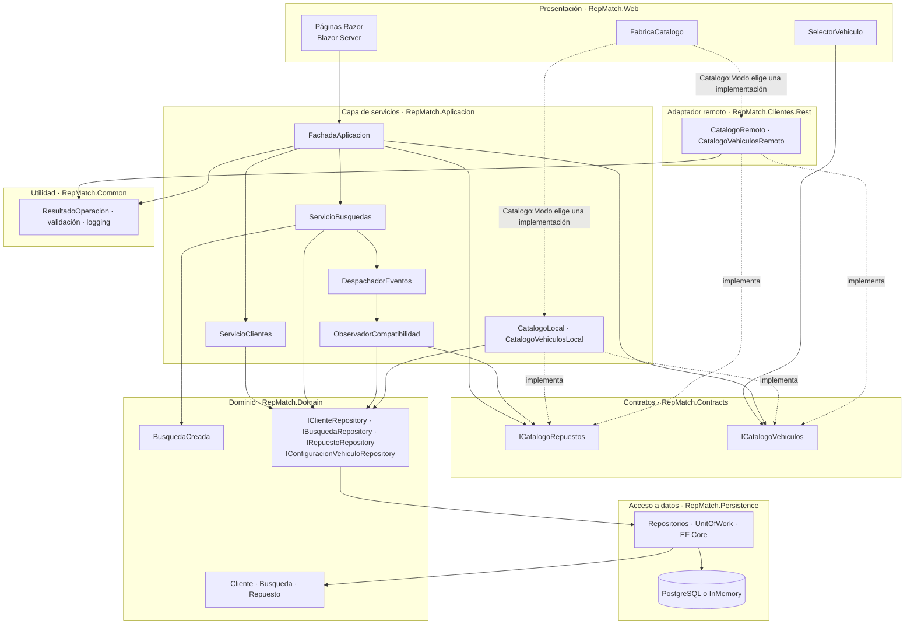

# Diagrama de arquitectura en capas — Primera Parte

Incluye la capa de servicios que pide la Primera Parte, la fachada por la que entra la presentación
y el despacho de eventos entre módulos.

`ICatalogoRepuestos` e `ICatalogoVehiculos` viven en `Contracts` y no dependen de Persistence. Las
implementaciones locales están en `Aplicacion` y llegan a la base por las interfaces de repositorio.
Las remotas están en `Clientes.Rest` y salen por HTTP; no tocan Persistence. `FabricaCatalogo`
enlaza cada contrato con una sola de las dos al arrancar.

La presentación no referencia repositorios ni el despachador. Las páginas entran por la fachada.
`SelectorVehiculo` consulta `ICatalogoVehiculos` para cargar las opciones, y la fachada usa el mismo
contrato para validar el vehículo antes de consultar piezas. `ServicioBusquedas` persiste la
búsqueda y publica `BusquedaCreada`. El observador, no el servicio, consulta el catálogo.
`Aplicacion` y `Clientes.Rest` usan `Common`.
