# Diagrama de arquitectura en capas — Primera Parte

Incluye la capa de servicios que pide la Primera Parte, la fachada por la que entra la presentación
y el despacho de eventos entre módulos. El componente de IA de la Segunda Parte se suma como un
contrato más (`IDiagnosticador`), con la misma separación local/remoto que el catálogo.

```mermaid
flowchart TB
    subgraph presentacion["Presentación · RepMatch.Web"]
        WEB["Páginas Razor<br/>Blazor Server"]
        SEL["SelectorVehiculo"]
        FAB["FabricaCatalogo · FabricaDiagnostico"]
    end

    subgraph servicios["Capa de servicios · RepMatch.Aplicacion"]
        FAC["FachadaAplicacion"]
        SC["ServicioClientes"]
        SB["ServicioBusquedas"]
        SM["ServicioMecanicos · ServicioRevisiones<br/>ServicioDerivaciones"]
        DES["DespachadorEventos"]
        OBS["ObservadorCompatibilidad"]
        SD["ServicioDiagnostico"]
        SO["ServicioOfertas"]
        LOC["CatalogoLocal · CatalogoVehiculosLocal"]
    end

    subgraph ia["Componente de IA · RepMatch.IA"]
        IAL["DiagnosticadorConRespaldo<br/>DiagnosticadorLlm · DiagnosticadorLocal"]
    end

    subgraph remoto["Adaptador remoto · RepMatch.Clientes.Rest"]
        REM["CatalogoRemoto · CatalogoVehiculosRemoto<br/>DiagnosticadorRemoto"]
    end

    subgraph soap["Adaptador SOAP · RepMatch.Clientes.Soap"]
        SOA["CatalogoSoap<br/>proxy generado desde el WSDL"]
    end

    subgraph vtex["Adaptador de API externa · RepMatch.Fuentes.Vtex"]
        VTX["FuenteVtex · LectorVtex<br/>una instancia por tienda"]
    end

    TIENDAS(["Tiendas VTEX<br/>Easy · Frávega"])

    subgraph contratos["Contratos · RepMatch.Contracts"]
        IC["ICatalogoRepuestos"]
        ICV["ICatalogoVehiculos"]
        ID["IDiagnosticador"]
        IFO["IFuenteOfertas"]
    end

    subgraph utilidad["Utilidad · RepMatch.Common"]
        COM["ResultadoOperacion · validación · logging"]
    end

    subgraph dominio["Dominio · RepMatch.Domain"]
        ENT["Cliente · Busqueda · Repuesto · Derivacion"]
        EV["BusquedaCreada · BusquedaCompartida<br/>DiagnosticoValidado · DerivacionATienda"]
        REPO["IClienteRepository · IBusquedaRepository · IRepuestoRepository<br/>IConfiguracionVehiculoRepository · IDerivacionRepository"]
    end

    subgraph datos["Acceso a datos · RepMatch.Persistence"]
        PER["Repositorios · UnitOfWork · EF Core"]
        BD[("PostgreSQL o InMemory")]
    end

    WEB --> FAC
    SEL --> ICV
    FAB -. "Catalogo:Modo elige una implementación" .-> LOC
    FAB -. "Catalogo:Modo elige una implementación" .-> REM
    FAB -. "Catalogo:Modo elige una implementación" .-> SOA
    FAB -. "IA:Modo elige una implementación" .-> IAL
    FAC --> SC
    FAC --> SB
    FAC --> SM
    FAC --> SD
    FAC --> SO
    SO --> IFO
    SO --> IC
    SO --> REPO
    VTX -. implementa .-> IFO
    VTX --> COM
    VTX == "HTTPS · JSON" ==> TIENDAS
    FAC --> IC
    FAC --> ICV
    FAC --> COM
    SB --> DES
    SM --> DES
    DES --> OBS
    OBS --> SD
    SD --> IC
    SD --> ID
    SC --> REPO
    SB --> REPO
    OBS --> REPO
    SM --> REPO
    SB --> EV
    SM --> EV
    LOC -. implementa .-> IC
    LOC -. implementa .-> ICV
    REM -. implementa .-> IC
    REM -. implementa .-> ICV
    REM -. implementa .-> ID
    SOA -. implementa .-> IC
    SOA --> COM
    IAL -. implementa .-> ID
    IAL --> COM
    LOC --> REPO
    REM --> COM
    REPO --> PER
    PER --> ENT
    PER --> BD
```

`ICatalogoRepuestos` e `ICatalogoVehiculos` viven en `Contracts` y no dependen de Persistence. Las
implementaciones locales están en `Aplicacion` y llegan a la base por las interfaces de repositorio.
Las remotas están en `Clientes.Rest` y salen por HTTP; la de SOAP (Segunda Parte), en
`Clientes.Soap`, sale por SOAP contra `Catalogo.Soap`. Ninguna toca Persistence. `FabricaCatalogo`
enlaza cada contrato con una sola implementación al arrancar; en modo `Soap`, repuestos por SOAP y
vehículos por REST. `IFuenteOfertas` es distinto: no se elige una, `ServicioOfertas` usa todas las
tiendas configuradas a la vez, y cada `FuenteVtex` sale por HTTPS a la API pública de su tienda.

La presentación no referencia repositorios ni el despachador. Las páginas entran por la fachada.
`SelectorVehiculo` consulta `ICatalogoVehiculos` para cargar las opciones, y la fachada usa el mismo
contrato para validar el vehículo antes de consultar piezas. `ServicioBusquedas` persiste la
búsqueda y publica `BusquedaCreada`. El observador, no el servicio, consulta el catálogo y la IA, a
través de `ServicioDiagnostico`; la fachada usa el mismo servicio para la búsqueda sin sesión.
`IDiagnosticador` se resuelve en proceso con `RepMatch.IA` o por HTTP con `DiagnosticadorRemoto`
contra `IA.Api`; ninguna de las dos toca Persistence.
`ServicioRevisiones` y `ServicioDerivaciones` siguen el mismo orden —confirmar y después despachar—
con `BusquedaCompartida`, `DiagnosticoValidado` y `DerivacionATienda`, que hoy no tienen
observadores. El endpoint `GET /derivar/{ofertaId}` de la Web también entra por la fachada.
`Aplicacion`, `IA`, `Clientes.Rest` y `Clientes.Soap` usan `Common`.
