# Diagrama de arquitectura en capas — Primera Parte

Incluye la capa de servicios que pide la Primera Parte, la fachada por la que entra la presentación
y el despacho de eventos entre módulos.

[Fuente Mermaid](fuentes/capas.mmd)

Los componentes Razor no llaman repositorios ni el despachador. `ServicioBusquedas` persiste la
búsqueda y publica `BusquedaCreada`. El observador, no el servicio, consulta el catálogo de repuestos. `SelectorVehiculo` consulta directamente `ICatalogoVehiculos`; la fachada usa ese contrato para validar las búsquedas.
