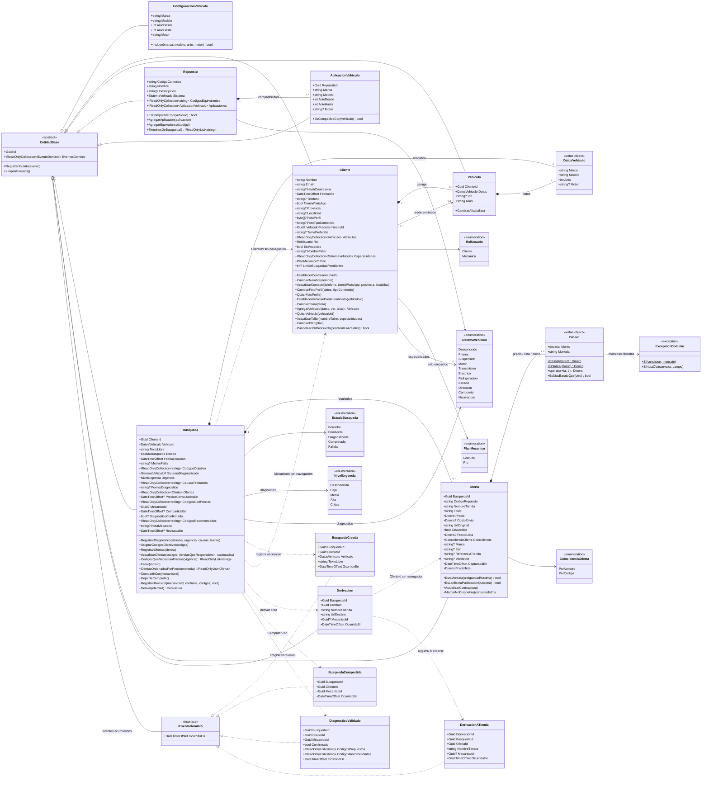

# Diagrama de clases — RepMatch

Tres diagramas. El primero es el modelo del componente de dominio (`RepMatch.Domain`), que no tiene
dependencias externas: ni EF Core, ni ASP.NET, ni atributos de persistencia. El mapeo relacional vive
aparte, en `RepMatch.Persistence/Configuraciones/`. El segundo muestra las clases de las otras capas
donde viven los patrones que pide la Primera Parte (Factory, Repository, Strategy, Observer y Facade),
más Unit of Work y Adapter. El tercero junta los dos, completos, y agrega las relaciones entre las
clases de los patrones y las entidades del dominio.

## Mapeo con la consigna

La consigna del TP Inicial pide un componente de dominio con `Pedido`, `Cliente` y `Producto`.
Como la aplicación es un comparador y no un e-shop, esos tres conceptos se materializan así:

| Consigna | RepMatch | Por qué |
|---|---|---|
| Cliente | `Cliente` | Igual: quien usa el comparador, con su garage de vehículos. La misma entidad representa al mecánico, distinguido por `Rol`. |
| Producto | `Repuesto` + `Oferta` | `Repuesto` es la pieza como concepto (código canónico, equivalencias, compatibilidad); `Oferta` es esa pieza publicada por una tienda concreta a un precio concreto. Separarlos es lo que permite comparar la misma pieza entre sitios. |
| Pedido | `Busqueda` | El agregado de la consulta: vehículo, texto libre, estado, diagnóstico de la IA y códigos objetivo. `Oferta` es lo que trae una tienda; `ServicioOfertas` las captura y las guarda en la búsqueda. |

## Modelo de dominio



## Decisiones que el diagrama refleja

**`DatosVehiculo` es value object, `Vehiculo` es entidad.** El vehículo del garage tiene identidad
propia (el cliente le pone un alias). La búsqueda, en cambio, guarda un *snapshot* de los datos: si
mañana el cliente borra el auto, la búsqueda histórica sigue siendo interpretable.

**`Dinero` existe para que no se puedan sumar monedas distintas.** El comparador mezcla ofertas en
ARS (tiendas VTEX argentinas) y en USD (eBay). Sumarlas sin cotización daría un ranking mentiroso,
así que el tipo lo prohíbe y lanza `ExcepcionDominio`.

**`Oferta.PrecioTotal` incluye el envío.** `OfertasOrdenadasPorPrecio` ordena por ese total y
rechaza mezclar monedas. Las tiendas VTEX no informan el envío en la búsqueda, así que hoy el total
es el precio; el día que una fuente lo informe, el ranking ya lo considera.

**Las ofertas se actualizan, no se reemplazan.** `ServicioOfertas` le pasa a
`Busqueda.ActualizarOfertas` lo que capturó. Si es la misma publicación de la misma tienda
(`EsLaMismaPublicacionQue`: referencia de la tienda, si no EAN, si no URL), `ActualizarCon` pisa el
precio y conserva el `Id`, porque una `Derivacion` puede apuntar a esa oferta. Lo que una tienda que
respondió dejó de publicar queda `MarcarNoDisponible`. `CodigosConPrecios` y `PreciosConsultadosEn`
evitan volver a preguntar mientras los precios estén vigentes.

**Estados que la aplicación alcanza.** El constructor deja la búsqueda en `Pendiente`.
`AsignarCodigosObjetivo` pasa a `Diagnosticada` y `Fallar` a `Fallida`. `Completada` la asignan
`RegistrarOfertas` y `ActualizarOfertas`, cuando se consultaron los precios. `Borrador` existe en la enumeración, pero ningún método lo asigna.

**El diagnóstico va aparte de los códigos.** `RegistrarDiagnostico` guarda lo que leyó la IA
(sistema, `NivelUrgencia`, causas y fuente) y `AsignarCodigosObjetivo` las piezas elegidas. Van
separados porque un diagnóstico puede no traer piezas del catálogo (un problema de embrague) y aun
así sirve. Si la IA no respondió, la búsqueda no tiene diagnóstico.

**Tipos declarados que la aplicación todavía no usa.** `Oferta.EstaVencida` no lo llama nadie: el
vencimiento se decide por búsqueda (`PreciosConsultadosEn`), no por oferta. Se dibuja porque está en
el componente.

**Las invariantes se rompen con `ExcepcionDominio`.** Todas las entidades y value objects la lanzan
desde sus constructores y métodos (`Si`, `SiNulaOVacia`); en el diagrama se dibuja una sola
dependencia, la de `Dinero`, para no cruzar todo el modelo de flechas. Los servicios de aplicación
la atrapan y la convierten en `ResultadoOperacion`.

**La búsqueda guarda `ClienteId` y no una navegación hacia `Cliente`.** No hay clave foránea. Si el
cliente borra la cuenta, las búsquedas se eliminan en el servicio, no por cascada de la base.

**El perfil del cliente protege sus invariantes.** La foto no puede estar vacía, tiene que ser JPG,
PNG o WEBP y no puede superar 5 MB. El teléfono admite dígitos, espacios, guiones, paréntesis y un
`+` inicial, entre 8 y 20 caracteres. El tema solo puede ser `"claro"` u `"oscuro"`. La provincia se
guarda como texto y no como enumeración: es un dato de contacto, no algo sobre lo que el dominio
decida. No hay ningún método para cambiar el email.

**El vehículo predeterminado tiene que ser del propio garage.** `EstablecerVehiculoPredeterminado`
rechaza un vehículo ajeno, y `QuitarVehiculo` limpia el predeterminado si se quita ese auto. Se
guarda solo el `Id` (sin navegación); en la base es una FK opcional con `ON DELETE SET NULL`.

**El mecánico es un `Cliente` con otro rol.** `Rol` se fija al registrarse. Solo un mecánico tiene
datos de taller (`NombreTaller`, `Especialidades`) y `Plan`; `ActualizarTaller` y `CambiarPlan`
rechazan a un cliente. Se descartó una entidad aparte porque duplicaba login, perfil y garage. El
plan `Gratuito` admite hasta `MaximoPendientesPlanGratuito` (5) búsquedas sin revisar en la bandeja;
`Pro` no tiene tope. `PuedeRecibirBusqueda` decide con la cantidad que cuenta el servicio.

**La revisión del mecánico no pisa el diagnóstico.** `CompartirCon` asigna `MecanicoId` (sin FK, como
`ClienteId`) y registra `BusquedaCompartida`. `RegistrarRevision` solo la acepta del mecánico
asignado y una sola vez: si confirma, recomienda los `CodigosObjetivo`; si corrige, exige al menos un
código. Los recomendados quedan en `CodigosRecomendados`, aparte de los propuestos, y
`DiagnosticoValidado` lleva los dos: es el dato etiquetado para medir la IA. `DejarDeCompartir` no
se permite una vez revisada.

**`Derivacion` es un agregado propio.** `Busqueda.Derivar` la crea para una oferta de la búsqueda y se
la atribuye al mecánico si revisó la búsqueda y recomendó ese código. No tiene FK a búsquedas ni a
clientes: es el registro de la comisión de afiliado y sobrevive a la baja de la cuenta. No cambia el
orden de las ofertas.

**Las colecciones se exponen como `IReadOnlyCollection`.** Modificarlas obliga a pasar por un método
de la entidad, que es donde viven las invariantes. EF Core escribe directamente los campos privados
de respaldo (`PropertyAccessMode.Field`).

## Clases de los patrones

El modelo de dominio no muestra los patrones de la Primera Parte: viven en `Aplicacion`,
`Persistence`, `Clientes.Rest`, `Contracts` y `Web`, y operan sobre las entidades de arriba. Este
diagrama muestra solo esas clases, con los miembros que intervienen en cada patrón. Cada patrón
está en un recuadro con su nombre (un `namespace` de Mermaid) y sus clases llevan el color de la
tabla de abajo. Mermaid no permite colorear el fondo de los recuadros de un diagrama de clases, por
eso el color va en las clases. `CatalogoRemoto`, `CatalogoVehiculosRemoto` y `CatalogoSoap` están en el recuadro de
Adapter, aunque también son estrategias de `ICatalogoRepuestos` / `ICatalogoVehiculos`: una clase solo
puede estar en un recuadro. Las clases grises son la capa de servicios, que no implementa ningún
patrón por sí misma. El detalle de cada patrón (qué problema resuelve, qué pasaría sin él, código)
está en [patrones.md](../patrones.md).

```mermaid
classDiagram
    direction TB

    namespace Facade {
        class FachadaAplicacion {
            <<Facade>>
            +RegistrarClienteAsync(dto) ResultadoOperacion~ClienteDto~
            +AutenticarAsync(email, contrasena) ClienteDto?
            +RegistrarBusquedaAsync(dto) ResultadoOperacion~BusquedaDto~
            +BuscarAsync(dto) ResultadoOperacion~ResultadoBusquedaDto~
            +BuscarRepuestosAsync(vehiculo, sistema) ResultadoOperacion
            +DiagnosticarAsync(vehiculo, texto) ResultadoOperacion~ResultadoDiagnosticoDto~
            +ListarRepuestosAsync() ResultadoOperacion
            +ListarMecanicosAsync(provincia) IReadOnlyList~MecanicoDto~
            +CompartirConsultaAsync(busquedaId, clienteId, mecanicoId) ResultadoOperacion~ConsultaDto~
            +RevisarConsultaAsync(busquedaId, mecanicoId, dto) ResultadoOperacion~ConsultaDto~
            +ObtenerBandejaAsync(mecanicoId) ResultadoOperacion~BandejaMecanicoDto~
            +CambiarPlanAsync(mecanicoId, plan) ResultadoOperacion~ClienteDto~
            +DerivarAsync(ofertaId) ResultadoOperacion~string~
            +ObtenerOfertasAsync(busquedaId, usuarioId, forzar) ResultadoOperacion~OfertasBusquedaDto~
            +ResumirPreciosAsync(piezas) ResumenPreciosBusquedaDto
        }
    }

    namespace Servicios {
        class ServicioClientes {
            +RegistrarAsync(dto) ResultadoOperacion~ClienteDto~
            +AgregarVehiculoAsync(clienteId, vehiculo, vin, alias) ResultadoOperacion~ClienteDto~
            +ActualizarPerfilAsync(clienteId, dto) ResultadoOperacion~ClienteDto~
            +EliminarCuentaAsync(clienteId, dto) ResultadoOperacion
        }

        class ServicioBusquedas {
            +CrearAsync(dto) ResultadoOperacion~BusquedaDto~
            +ListarPorClienteAsync(clienteId) IReadOnlyList~BusquedaDto~
            +ListarRecientesAsync(cantidad) IReadOnlyList~BusquedaDto~
        }

        class ServicioDiagnostico {

            +DiagnosticarAsync(vehiculo, texto) PiezasDiagnosticadas

        }


        class ServicioMecanicos {
            +ListarAsync(provincia) IReadOnlyList~MecanicoDto~
            +ActualizarTallerAsync(mecanicoId, dto) ResultadoOperacion~ClienteDto~
            +CambiarPlanAsync(mecanicoId, plan) ResultadoOperacion~ClienteDto~
        }

        class ServicioRevisiones {
            +ObtenerAsync(busquedaId, usuarioId) ConsultaDto?
            +CompartirAsync(busquedaId, clienteId, mecanicoId) ResultadoOperacion~ConsultaDto~
            +DejarDeCompartirAsync(busquedaId, clienteId) ResultadoOperacion~ConsultaDto~
            +ObtenerBandejaAsync(mecanicoId) ResultadoOperacion~BandejaMecanicoDto~
            +RevisarAsync(busquedaId, mecanicoId, dto) ResultadoOperacion~ConsultaDto~
        }

        class ServicioDerivaciones {
            +DerivarAsync(ofertaId) ResultadoOperacion~string~
        }

        class ServicioOfertas {
            +ObtenerAsync(busquedaId, usuarioId, forzar) ResultadoOperacion~OfertasBusquedaDto~
            +ResumirAsync(piezas) ResumenPreciosBusquedaDto
        }
    }

    namespace Factory {
        class FabricaCatalogo {
            <<Factory>>
            +AgregarCatalogo(servicios, configuracion)$ IServiceCollection
        }
    }

    namespace Strategy {
        class IDiagnosticador {
            <<interface>>
            +string Modo
            +DiagnosticarAsync(solicitud) DiagnosticoDto
        }
        class ICatalogoRepuestos {
            <<interface>>
            +string Modo
            +BuscarCompatiblesAsync(vehiculo, sistema) IReadOnlyList~RepuestoDto~
            +ObtenerPorCodigoAsync(codigo) RepuestoDto?
            +ListarAsync() IReadOnlyList~RepuestoDto~
        }

        class CatalogoLocal {
            <<Strategy>>
        }

        class ICatalogoVehiculos {
            <<interface>>
            +ListarOpcionesAsync() IReadOnlyList~OpcionVehiculoDto~
            +EsConfiguracionValidaAsync(vehiculo) bool
        }

        class CatalogoVehiculosLocal {
            <<Strategy>>
        }
    }

    namespace Adapter {
        class CatalogoRemoto {
            <<Strategy / Adapter>>
            -HttpClient http
        }

        class CatalogoVehiculosRemoto {
            <<Strategy / Adapter>>
            -HttpClient http
        }

        class CatalogoSoap {
            <<Strategy / Adapter>>
            -FabricaCanalSoap fabrica
        }

        class IFuenteOfertas {
            <<interface>>
            +string Nombre
            +BuscarAsync(consulta) IReadOnlyList~OfertaExternaDto~
        }

        class FuenteVtex {
            <<Adapter>>
            -OpcionesTiendaVtex tienda
            -IHttpClientFactory fabrica
        }
    }

    namespace Observer {
        class IDespachadorEventos {
            <<interface>>
            +DespacharAsync(eventos)
        }

        class DespachadorEventos {
            <<Observer: sujeto>>
            -IEnumerable~IObservadorEventoDominio~ observadores
        }

        class IObservadorEventoDominio {
            <<interface>>
            +PuedeObservar(evento) bool
            +ObservarAsync(evento)
        }

        class ObservadorCompatibilidad {
            <<Observer: observador>>
        }
    }

    namespace Repository {
        class IClienteRepository {
            <<interface>>
        }
        class IBusquedaRepository {
            <<interface>>
        }
        class IRepuestoRepository {
            <<interface>>
        }
        class IConfiguracionVehiculoRepository {
            <<interface>>
        }
        class ClienteRepository {
            <<Repository>>
        }
        class BusquedaRepository {
            <<Repository>>
        }
        class RepuestoRepository {
            <<Repository>>
        }
        class ConfiguracionVehiculoRepository {
            <<Repository>>
        }

        class IDerivacionRepository {
            <<interface>>
        }

        class DerivacionRepository {
            <<Repository>>
        }
    }

    namespace Unit_of_Work {
        class IUnitOfWork {
            <<interface>>
            +ConfirmarAsync() int
            +EjecutarEnTransaccionAsync(trabajo)
        }

        class UnitOfWork {
            <<Unit of Work>>
        }
    }

    FachadaAplicacion --> ServicioClientes
    FachadaAplicacion --> ServicioBusquedas
    FachadaAplicacion --> ICatalogoRepuestos
    FachadaAplicacion --> ICatalogoVehiculos
    FachadaAplicacion --> ServicioMecanicos
    FachadaAplicacion --> ServicioRevisiones
    FachadaAplicacion --> ServicioDerivaciones
    FachadaAplicacion --> ServicioDiagnostico
    FachadaAplicacion --> ServicioOfertas

    FabricaCatalogo ..> CatalogoLocal : registra
    FabricaCatalogo ..> CatalogoRemoto : registra
    FabricaCatalogo ..> CatalogoSoap : registra
    FabricaCatalogo ..> CatalogoVehiculosLocal : registra
    FabricaCatalogo ..> CatalogoVehiculosRemoto : registra
    FabricaCatalogo ..> ICatalogoRepuestos : enlaza segun Catalogo Modo
    FabricaCatalogo ..> ICatalogoVehiculos : enlaza segun Catalogo Modo

    ICatalogoRepuestos <|.. CatalogoLocal
    ICatalogoRepuestos <|.. CatalogoRemoto
    ICatalogoRepuestos <|.. CatalogoSoap
    ICatalogoVehiculos <|.. CatalogoVehiculosLocal
    ICatalogoVehiculos <|.. CatalogoVehiculosRemoto

    ServicioBusquedas --> IDespachadorEventos : BusquedaCreada
    IDespachadorEventos <|.. DespachadorEventos
    DespachadorEventos o-- "0..*" IObservadorEventoDominio : notifica
    IObservadorEventoDominio <|.. ObservadorCompatibilidad
    ObservadorCompatibilidad --> ServicioDiagnostico
    ServicioDiagnostico --> ICatalogoRepuestos
    ServicioDiagnostico --> IDiagnosticador : elige entre las compatibles
    ServicioRevisiones --> IDespachadorEventos : BusquedaCompartida, DiagnosticoValidado
    ServicioDerivaciones --> IDespachadorEventos : DerivacionATienda

    ServicioClientes --> IClienteRepository
    ServicioClientes --> IConfiguracionVehiculoRepository
    ServicioClientes --> IBusquedaRepository : borra al eliminar cuenta
    ServicioBusquedas --> IBusquedaRepository
    ServicioBusquedas --> IClienteRepository
    ObservadorCompatibilidad --> IBusquedaRepository
    CatalogoLocal --> IRepuestoRepository
    CatalogoVehiculosLocal --> IConfiguracionVehiculoRepository
    ServicioMecanicos --> IClienteRepository
    ServicioRevisiones --> IBusquedaRepository
    ServicioRevisiones --> IClienteRepository : rol y limite del plan
    ServicioRevisiones --> IDerivacionRepository : cuenta derivaciones
    ServicioDerivaciones --> IBusquedaRepository
    ServicioDerivaciones --> IDerivacionRepository
    ServicioOfertas --> IBusquedaRepository
    ServicioOfertas --> ICatalogoRepuestos : nombre y equivalencias
    ServicioOfertas --> "0..*" IFuenteOfertas : todas en paralelo
    IFuenteOfertas <|.. FuenteVtex

    IClienteRepository <|.. ClienteRepository
    IBusquedaRepository <|.. BusquedaRepository
    IRepuestoRepository <|.. RepuestoRepository
    IConfiguracionVehiculoRepository <|.. ConfiguracionVehiculoRepository
    IDerivacionRepository <|.. DerivacionRepository

    ServicioClientes --> IUnitOfWork
    ServicioBusquedas --> IUnitOfWork
    ObservadorCompatibilidad --> IUnitOfWork
    ServicioMecanicos --> IUnitOfWork
    ServicioRevisiones --> IUnitOfWork
    ServicioDerivaciones --> IUnitOfWork
    ServicioOfertas --> IUnitOfWork
    IUnitOfWork <|.. UnitOfWork

    style FachadaAplicacion fill:#fce7f3,stroke:#be185d,stroke-width:2px,color:#111
    style ServicioClientes fill:#f3f4f6,stroke:#6b7280,stroke-width:1px,color:#111
    style ServicioBusquedas fill:#f3f4f6,stroke:#6b7280,stroke-width:1px,color:#111
    style ServicioMecanicos fill:#f3f4f6,stroke:#6b7280,stroke-width:1px,color:#111
    style ServicioRevisiones fill:#f3f4f6,stroke:#6b7280,stroke-width:1px,color:#111
    style ServicioDerivaciones fill:#f3f4f6,stroke:#6b7280,stroke-width:1px,color:#111
    style ServicioDiagnostico fill:#f3f4f6,stroke:#6b7280,stroke-width:1px,color:#111
    style ServicioOfertas fill:#f3f4f6,stroke:#6b7280,stroke-width:1px,color:#111
    style FabricaCatalogo fill:#fee2e2,stroke:#b91c1c,stroke-width:2px,color:#111
    style ICatalogoRepuestos fill:#dbeafe,stroke:#1d4ed8,stroke-width:2px,color:#111
    style IDiagnosticador fill:#dbeafe,stroke:#1d4ed8,stroke-width:2px,color:#111
    style CatalogoLocal fill:#dbeafe,stroke:#1d4ed8,stroke-width:2px,color:#111
    style ICatalogoVehiculos fill:#dbeafe,stroke:#1d4ed8,stroke-width:2px,color:#111
    style CatalogoVehiculosLocal fill:#dbeafe,stroke:#1d4ed8,stroke-width:2px,color:#111
    style CatalogoRemoto fill:#ede9fe,stroke:#6d28d9,stroke-width:2px,color:#111
    style CatalogoSoap fill:#ede9fe,stroke:#6d28d9,stroke-width:2px,color:#111
    style IFuenteOfertas fill:#ede9fe,stroke:#6d28d9,stroke-width:2px,color:#111
    style FuenteVtex fill:#ede9fe,stroke:#6d28d9,stroke-width:2px,color:#111
    style CatalogoVehiculosRemoto fill:#ede9fe,stroke:#6d28d9,stroke-width:2px,color:#111
    style IDespachadorEventos fill:#fef3c7,stroke:#b45309,stroke-width:2px,color:#111
    style DespachadorEventos fill:#fef3c7,stroke:#b45309,stroke-width:2px,color:#111
    style IObservadorEventoDominio fill:#fef3c7,stroke:#b45309,stroke-width:2px,color:#111
    style ObservadorCompatibilidad fill:#fef3c7,stroke:#b45309,stroke-width:2px,color:#111
    style IClienteRepository fill:#dcfce7,stroke:#15803d,stroke-width:2px,color:#111
    style IBusquedaRepository fill:#dcfce7,stroke:#15803d,stroke-width:2px,color:#111
    style IRepuestoRepository fill:#dcfce7,stroke:#15803d,stroke-width:2px,color:#111
    style IConfiguracionVehiculoRepository fill:#dcfce7,stroke:#15803d,stroke-width:2px,color:#111
    style ClienteRepository fill:#dcfce7,stroke:#15803d,stroke-width:2px,color:#111
    style BusquedaRepository fill:#dcfce7,stroke:#15803d,stroke-width:2px,color:#111
    style RepuestoRepository fill:#dcfce7,stroke:#15803d,stroke-width:2px,color:#111
    style ConfiguracionVehiculoRepository fill:#dcfce7,stroke:#15803d,stroke-width:2px,color:#111
    style IDerivacionRepository fill:#dcfce7,stroke:#15803d,stroke-width:2px,color:#111
    style DerivacionRepository fill:#dcfce7,stroke:#15803d,stroke-width:2px,color:#111
    style IUnitOfWork fill:#ccfbf1,stroke:#0f766e,stroke-width:2px,color:#111
    style UnitOfWork fill:#ccfbf1,stroke:#0f766e,stroke-width:2px,color:#111
```



| Patrón | Color | Clases en el diagrama | Proyecto |
|---|---|---|---|
| Factory | Rojo | `FabricaCatalogo.AgregarCatalogo`; `FabricaDiagnostico.AgregarDiagnostico` repite el patrón para `IDiagnosticador` y no se dibuja | `RepMatch.Web` |
| Strategy | Azul | `ICatalogoRepuestos` / `ICatalogoVehiculos` con sus implementaciones `*Local` y `*Remoto`; `IDiagnosticador`, cuyas implementaciones (`DiagnosticadorLlm`, `DiagnosticadorLocal`, `DiagnosticadorConRespaldo` en `RepMatch.IA` y `DiagnosticadorRemoto`) se describen en [patrones.md](../patrones.md#el-componente-de-ia-y-los-mismos-patrones) y no se dibujan | `Contracts`, `Aplicacion`, `Clientes.Rest`, `IA` |
| Adapter | Violeta | `CatalogoRemoto`, `CatalogoVehiculosRemoto` (HTTP → contrato); `CatalogoSoap` (SOAP → contrato, Segunda Parte); `FuenteVtex` (API pública de las tiendas VTEX → `IFuenteOfertas`, Segunda Parte) | `RepMatch.Clientes.Rest`, `RepMatch.Clientes.Soap`, `RepMatch.Fuentes.Vtex` |
| Repository | Verde | `I*Repository` (interfaces) y `*Repository` (EF Core) | `Domain` y `Persistence` |
| Unit of Work | Turquesa | `IUnitOfWork` / `UnitOfWork` | `Domain` y `Persistence` |
| Observer | Ámbar | `IDespachadorEventos`, `DespachadorEventos`, `IObservadorEventoDominio`, `ObservadorCompatibilidad`; los eventos (`BusquedaCreada`, `BusquedaCompartida`, `DiagnosticoValidado`, `DerivacionATienda`) están en el modelo de dominio | `Aplicacion` y `Domain` |
| Facade | Rosa | `FachadaAplicacion` | `RepMatch.Aplicacion` |

Las interfaces de repositorio y de unidad de trabajo pertenecen al componente de dominio aunque se
dibujen acá: el dominio declara qué necesita y `Persistence` lo implementa, por eso la flecha de
dependencia apunta de la capa de datos hacia el dominio y no al revés.

## Vista completa: dominio y patrones

Los dos diagramas anteriores juntos, con todos sus miembros. El modelo de dominio queda en el
recuadro `Dominio` con su color por defecto y los patrones conservan su recuadro y su color. Lo que
agrega esta vista son las dependencias punteadas entre los dos mundos, que en los diagramas
separados no se ven:

| Desde (patrones) | Hacia (dominio) | Por qué |
|---|---|---|
| `IClienteRepository`, `IBusquedaRepository`, `IRepuestoRepository`, `IConfiguracionVehiculoRepository`, `IDerivacionRepository` | `Cliente`, `Busqueda`, `Repuesto`, `ConfiguracionVehiculo`, `Derivacion` | Cada repositorio persiste y recupera su entidad. |
| `ServicioClientes` | `Cliente` | Crea el cliente (con su rol) en el registro y lo modifica con sus métodos (perfil, garage, foto, tema). |
| `ServicioBusquedas` | `Busqueda` | Crea la búsqueda, que registra `BusquedaCreada` en su constructor. |
| `ServicioMecanicos` | `Cliente` | Cambia datos del taller y plan de un mecánico. |
| `ServicioRevisiones` | `Busqueda` | Comparte, retira y registra la revisión; chequea rol y límite del plan antes de llamar al dominio. |
| `ServicioDerivaciones` | `Busqueda` | Pide a la búsqueda la `Derivacion` de una oferta y la guarda. |
| `ServicioOfertas` | `Busqueda`, `Oferta` | Crea las `Oferta` de lo que trajeron las tiendas y se las pasa a `ActualizarOfertas`. |
| `CatalogoLocal`, `CatalogoVehiculosLocal` | `Repuesto`, `ConfiguracionVehiculo` | Las estrategias locales leen entidades y las traducen a DTOs. Las remotas no tocan el dominio: solo ven DTOs. |
| `IDespachadorEventos`, `IObservadorEventoDominio` | `IEventoDominio` | El Observer trabaja sobre el contrato de evento del dominio, no sobre eventos concretos. |
| `ObservadorCompatibilidad` | `BusquedaCreada`, `Busqueda` | Reacciona al evento, pide a `ServicioDiagnostico` las piezas y el diagnóstico, y completa la búsqueda con `RegistrarDiagnostico` y `AsignarCodigosObjetivo` o la cierra con `Fallar`. |

`FachadaAplicacion`, `FabricaCatalogo` y los adaptadores remotos no tienen ninguna flecha hacia el
dominio: la presentación y el acceso remoto se comunican solo con DTOs de `RepMatch.Contracts`.

```mermaid
classDiagram
    direction TB

    namespace Dominio {
        class EntidadBase {
            <<abstract>>
            +Guid Id
            +IReadOnlyCollection~IEventoDominio~ EventosDominio
            #RegistrarEvento(evento)
            +LimpiarEventos()
        }

        class DatosVehiculo {
            <<value object>>
            +string Marca
            +string Modelo
            +int Anio
            +string? Motor
        }

        class Dinero {
            <<value object>>
            +decimal Monto
            +string Moneda
            +Pesos(monto)$ Dinero
            +Dolares(monto)$ Dinero
            +operator+(a, b) Dinero
            +EsMasBaratoQue(otro) bool
        }

        class Cliente {
            +string Nombre
            +string Email
            +string? HashContrasena
            +DateTimeOffset FechaAlta
            +string? Telefono
            +bool TieneWhatsApp
            +string? Provincia
            +string? Localidad
            +byte[]? FotoPerfil
            +string? FotoTipoContenido
            +Guid? VehiculoPredeterminadoId
            +string? TemaPreferido
            +IReadOnlyCollection~Vehiculo~ Vehiculos
            +RolUsuario Rol
            +bool EsMecanico
            +string? NombreTaller
            +IReadOnlyCollection~SistemaVehiculo~ Especialidades
            +PlanMecanico? Plan
            +int? LimiteBusquedasPendientes
            +EstablecerContrasena(hash)
            +CambiarNombre(nombre)
            +ActualizarContacto(telefono, tieneWhatsApp, provincia, localidad)
            +CambiarFotoPerfil(datos, tipoContenido)
            +QuitarFotoPerfil()
            +EstablecerVehiculoPredeterminado(vehiculoId)
            +CambiarTema(tema)
            +AgregarVehiculo(datos, vin, alias) Vehiculo
            +QuitarVehiculo(vehiculoId)
            +ActualizarTaller(nombreTaller, especialidades)
            +CambiarPlan(plan)
            +PuedeRecibirBusqueda(pendientesActuales) bool
        }

        class Vehiculo {
            +Guid ClienteId
            +DatosVehiculo Datos
            +string? Vin
            +string Alias
            +CambiarAlias(alias)
        }

        class ConfiguracionVehiculo {
            +string Marca
            +string Modelo
            +int AnioDesde
            +int AnioHasta
            +string Motor
            +Incluye(marca, modelo, anio, motor) bool
        }

        class Repuesto {
            +string CodigoCanonico
            +string Nombre
            +string? Descripcion
            +SistemaVehiculo Sistema
            +IReadOnlyCollection~string~ CodigosEquivalentes
            +IReadOnlyCollection~AplicacionVehiculo~ Aplicaciones
            +EsCompatibleCon(vehiculo) bool
            +AgregarAplicacion(aplicacion)
            +AgregarEquivalencia(codigo)
            +TerminosDeBusqueda() IReadOnlyList~string~
        }

        class AplicacionVehiculo {
            +Guid RepuestoId
            +string Marca
            +string Modelo
            +int AnioDesde
            +int AnioHasta
            +string? Motor
            +EsCompatibleCon(vehiculo) bool
        }

        class Busqueda {
            +Guid ClienteId
            +DatosVehiculo Vehiculo
            +string TextoLibre
            +EstadoBusqueda Estado
            +DateTimeOffset FechaCreacion
            +string? MotivoFalla
            +IReadOnlyCollection~string~ CodigosObjetivo
            +SistemaVehiculo? SistemaDiagnosticado
            +NivelUrgencia Urgencia
            +IReadOnlyCollection~string~ CausasProbables
            +string? FuenteDiagnostico
            +IReadOnlyCollection~Oferta~ Ofertas
            +DateTimeOffset? PreciosConsultadosEn
            +IReadOnlyCollection~string~ CodigosConPrecios
            +Guid? MecanicoId
            +DateTimeOffset? CompartidaEn
            +bool? DiagnosticoConfirmado
            +IReadOnlyCollection~string~ CodigosRecomendados
            +string? NotaMecanico
            +DateTimeOffset? RevisadaEn
            +RegistrarDiagnostico(sistema, urgencia, causas, fuente)
            +AsignarCodigosObjetivo(codigos)
            +RegistrarOfertas(ofertas)
            +ActualizarOfertas(codigos, tiendasQueRespondieron, capturadas)
            +CodigosQueNecesitanPrecios(vigencia) IReadOnlyList~string~
            +Fallar(motivo)
            +OfertasOrdenadasPorPrecio(moneda) IReadOnlyList~Oferta~
            +CompartirCon(mecanicoId)
            +DejarDeCompartir()
            +RegistrarRevision(mecanicoId, confirma, codigos, nota)
            +Derivar(ofertaId) Derivacion
        }

        class Oferta {
            +Guid BusquedaId
            +string CodigoRepuesto
            +string NombreTienda
            +string Titulo
            +Dinero Precio
            +Dinero? CostoEnvio
            +string UrlOriginal
            +bool Disponible
            +Dinero? PrecioLista
            +CoincidenciaOferta Coincidencia
            +string? Marca
            +string? Ean
            +string? ReferenciaTienda
            +string? Vendedor
            +DateTimeOffset CapturadaEn
            +Dinero PrecioTotal
            +EstaVencida(antiguedadMaxima) bool
            +EsLaMismaPublicacionQue(otra) bool
            +ActualizarCon(captura)
            +MarcarNoDisponible(consultadaEn)
        }

        class Derivacion {
            +Guid BusquedaId
            +Guid OfertaId
            +string NombreTienda
            +string UrlDestino
            +Guid? MecanicoId
            +DateTimeOffset OcurridaEn
        }

        class SistemaVehiculo {
            <<enumeration>>
            Desconocido
            Frenos
            Suspension
            Motor
            Transmision
            Electrico
            Refrigeracion
            Escape
            Direccion
            Carroceria
            Neumaticos
        }

        class IEventoDominio {
            <<interface>>
            +DateTimeOffset OcurridoEn
        }

        class BusquedaCreada {
            +Guid BusquedaId
            +Guid ClienteId
            +DatosVehiculo Vehiculo
            +string TextoLibre
            +DateTimeOffset OcurridoEn
        }

        class BusquedaCompartida {
            +Guid BusquedaId
            +Guid ClienteId
            +Guid MecanicoId
            +DateTimeOffset OcurridoEn
        }

        class DiagnosticoValidado {
            +Guid BusquedaId
            +Guid ClienteId
            +Guid MecanicoId
            +bool Confirmado
            +IReadOnlyList~string~ CodigosPropuestos
            +IReadOnlyList~string~ CodigosRecomendados
            +DateTimeOffset OcurridoEn
        }

        class DerivacionATienda {
            +Guid DerivacionId
            +Guid BusquedaId
            +Guid OfertaId
            +string NombreTienda
            +Guid? MecanicoId
            +DateTimeOffset OcurridoEn
        }

        class EstadoBusqueda {
            <<enumeration>>
            Borrador
            Pendiente
            Diagnosticada
            Completada
            Fallida
        }

        class NivelUrgencia {
            <<enumeration>>
            Desconocida
            Baja
            Media
            Alta
            Critica
        }

        class RolUsuario {
            <<enumeration>>
            Cliente
            Mecanico
        }

        class PlanMecanico {
            <<enumeration>>
            Gratuito
            Pro
        }

        class CoincidenciaOferta {
            <<enumeration>>
            PorNombre
            PorCodigo
        }

        class ExcepcionDominio {
            <<exception>>
            +Si(condicion, mensaje)$
            +SiNulaOVacia(valor, campo)$
        }
    }

    EntidadBase <|-- ConfiguracionVehiculo
    EntidadBase <|-- Cliente
    EntidadBase <|-- Vehiculo
    EntidadBase <|-- Repuesto
    EntidadBase <|-- AplicacionVehiculo
    EntidadBase <|-- Busqueda
    EntidadBase <|-- Oferta
    EntidadBase <|-- Derivacion
    Cliente "1" *-- "0..*" Vehiculo : garage
    Cliente "0..1" --> "0..1" Vehiculo : predeterminado
    Vehiculo *-- "1" DatosVehiculo : datos
    Repuesto "1" *-- "0..*" AplicacionVehiculo : compatibilidad
    Repuesto --> SistemaVehiculo
    Busqueda *-- "1" DatosVehiculo : snapshot
    Busqueda ..> Cliente : ClienteId sin navegacion
    Busqueda "1" *-- "0..*" Oferta : resultados
    Busqueda --> EstadoBusqueda
    Busqueda --> NivelUrgencia : diagnostico
    Busqueda --> SistemaVehiculo : diagnostico
    IEventoDominio <|.. BusquedaCreada
    EntidadBase o-- IEventoDominio : eventos acumulados
    Busqueda ..> BusquedaCreada : registra al crearse
    Cliente --> RolUsuario
    Cliente --> PlanMecanico : solo mecanico
    Cliente --> "0..*" SistemaVehiculo : especialidades
    Busqueda ..> Cliente : MecanicoId sin navegacion
    Busqueda ..> Derivacion : Derivar crea
    Derivacion ..> Oferta : OfertaId sin navegacion
    IEventoDominio <|.. BusquedaCompartida
    IEventoDominio <|.. DiagnosticoValidado
    IEventoDominio <|.. DerivacionATienda
    Busqueda ..> BusquedaCompartida : CompartirCon
    Busqueda ..> DiagnosticoValidado : RegistrarRevision
    Derivacion ..> DerivacionATienda : registra al crearse
    Oferta *-- "1..3" Dinero : precio / lista / envio
    Oferta --> CoincidenciaOferta
    Dinero ..> ExcepcionDominio : monedas distintas

    namespace Facade {
        class FachadaAplicacion {
            <<Facade>>
            +RegistrarClienteAsync(dto) ResultadoOperacion~ClienteDto~
            +AutenticarAsync(email, contrasena) ClienteDto?
            +RegistrarBusquedaAsync(dto) ResultadoOperacion~BusquedaDto~
            +BuscarAsync(dto) ResultadoOperacion~ResultadoBusquedaDto~
            +BuscarRepuestosAsync(vehiculo, sistema) ResultadoOperacion
            +DiagnosticarAsync(vehiculo, texto) ResultadoOperacion~ResultadoDiagnosticoDto~
            +ListarRepuestosAsync() ResultadoOperacion
            +ListarMecanicosAsync(provincia) IReadOnlyList~MecanicoDto~
            +CompartirConsultaAsync(busquedaId, clienteId, mecanicoId) ResultadoOperacion~ConsultaDto~
            +RevisarConsultaAsync(busquedaId, mecanicoId, dto) ResultadoOperacion~ConsultaDto~
            +ObtenerBandejaAsync(mecanicoId) ResultadoOperacion~BandejaMecanicoDto~
            +CambiarPlanAsync(mecanicoId, plan) ResultadoOperacion~ClienteDto~
            +DerivarAsync(ofertaId) ResultadoOperacion~string~
            +ObtenerOfertasAsync(busquedaId, usuarioId, forzar) ResultadoOperacion~OfertasBusquedaDto~
            +ResumirPreciosAsync(piezas) ResumenPreciosBusquedaDto
        }
    }

    namespace Servicios {
        class ServicioClientes {
            +RegistrarAsync(dto) ResultadoOperacion~ClienteDto~
            +AgregarVehiculoAsync(clienteId, vehiculo, vin, alias) ResultadoOperacion~ClienteDto~
            +ActualizarPerfilAsync(clienteId, dto) ResultadoOperacion~ClienteDto~
            +EliminarCuentaAsync(clienteId, dto) ResultadoOperacion
        }

        class ServicioBusquedas {
            +CrearAsync(dto) ResultadoOperacion~BusquedaDto~
            +ListarPorClienteAsync(clienteId) IReadOnlyList~BusquedaDto~
            +ListarRecientesAsync(cantidad) IReadOnlyList~BusquedaDto~
        }

        class ServicioDiagnostico {

            +DiagnosticarAsync(vehiculo, texto) PiezasDiagnosticadas

        }


        class ServicioMecanicos {
            +ListarAsync(provincia) IReadOnlyList~MecanicoDto~
            +ActualizarTallerAsync(mecanicoId, dto) ResultadoOperacion~ClienteDto~
            +CambiarPlanAsync(mecanicoId, plan) ResultadoOperacion~ClienteDto~
        }

        class ServicioRevisiones {
            +ObtenerAsync(busquedaId, usuarioId) ConsultaDto?
            +CompartirAsync(busquedaId, clienteId, mecanicoId) ResultadoOperacion~ConsultaDto~
            +DejarDeCompartirAsync(busquedaId, clienteId) ResultadoOperacion~ConsultaDto~
            +ObtenerBandejaAsync(mecanicoId) ResultadoOperacion~BandejaMecanicoDto~
            +RevisarAsync(busquedaId, mecanicoId, dto) ResultadoOperacion~ConsultaDto~
        }

        class ServicioDerivaciones {
            +DerivarAsync(ofertaId) ResultadoOperacion~string~
        }

        class ServicioOfertas {
            +ObtenerAsync(busquedaId, usuarioId, forzar) ResultadoOperacion~OfertasBusquedaDto~
            +ResumirAsync(piezas) ResumenPreciosBusquedaDto
        }
    }

    namespace Factory {
        class FabricaCatalogo {
            <<Factory>>
            +AgregarCatalogo(servicios, configuracion)$ IServiceCollection
        }
    }

    namespace Strategy {
        class IDiagnosticador {
            <<interface>>
            +string Modo
            +DiagnosticarAsync(solicitud) DiagnosticoDto
        }
        class ICatalogoRepuestos {
            <<interface>>
            +string Modo
            +BuscarCompatiblesAsync(vehiculo, sistema) IReadOnlyList~RepuestoDto~
            +ObtenerPorCodigoAsync(codigo) RepuestoDto?
            +ListarAsync() IReadOnlyList~RepuestoDto~
        }

        class CatalogoLocal {
            <<Strategy>>
        }

        class ICatalogoVehiculos {
            <<interface>>
            +ListarOpcionesAsync() IReadOnlyList~OpcionVehiculoDto~
            +EsConfiguracionValidaAsync(vehiculo) bool
        }

        class CatalogoVehiculosLocal {
            <<Strategy>>
        }
    }

    namespace Adapter {
        class CatalogoRemoto {
            <<Strategy / Adapter>>
            -HttpClient http
        }

        class CatalogoVehiculosRemoto {
            <<Strategy / Adapter>>
            -HttpClient http
        }

        class CatalogoSoap {
            <<Strategy / Adapter>>
            -FabricaCanalSoap fabrica
        }

        class IFuenteOfertas {
            <<interface>>
            +string Nombre
            +BuscarAsync(consulta) IReadOnlyList~OfertaExternaDto~
        }

        class FuenteVtex {
            <<Adapter>>
            -OpcionesTiendaVtex tienda
            -IHttpClientFactory fabrica
        }
    }

    namespace Observer {
        class IDespachadorEventos {
            <<interface>>
            +DespacharAsync(eventos)
        }

        class DespachadorEventos {
            <<Observer: sujeto>>
            -IEnumerable~IObservadorEventoDominio~ observadores
        }

        class IObservadorEventoDominio {
            <<interface>>
            +PuedeObservar(evento) bool
            +ObservarAsync(evento)
        }

        class ObservadorCompatibilidad {
            <<Observer: observador>>
        }
    }

    namespace Repository {
        class IClienteRepository {
            <<interface>>
        }

        class IBusquedaRepository {
            <<interface>>
        }

        class IRepuestoRepository {
            <<interface>>
        }

        class IConfiguracionVehiculoRepository {
            <<interface>>
        }

        class ClienteRepository {
            <<Repository>>
        }

        class BusquedaRepository {
            <<Repository>>
        }

        class RepuestoRepository {
            <<Repository>>
        }

        class ConfiguracionVehiculoRepository {
            <<Repository>>
        }

        class IDerivacionRepository {
            <<interface>>
        }

        class DerivacionRepository {
            <<Repository>>
        }
    }

    namespace Unit_of_Work {
        class IUnitOfWork {
            <<interface>>
            +ConfirmarAsync() int
            +EjecutarEnTransaccionAsync(trabajo)
        }

        class UnitOfWork {
            <<Unit of Work>>
        }
    }

    FachadaAplicacion --> ServicioClientes
    FachadaAplicacion --> ServicioBusquedas
    FachadaAplicacion --> ICatalogoRepuestos
    FachadaAplicacion --> ICatalogoVehiculos
    FachadaAplicacion --> ServicioMecanicos
    FachadaAplicacion --> ServicioRevisiones
    FachadaAplicacion --> ServicioDerivaciones
    FachadaAplicacion --> ServicioDiagnostico
    FachadaAplicacion --> ServicioOfertas

    FabricaCatalogo ..> CatalogoLocal : registra
    FabricaCatalogo ..> CatalogoRemoto : registra
    FabricaCatalogo ..> CatalogoSoap : registra
    FabricaCatalogo ..> CatalogoVehiculosLocal : registra
    FabricaCatalogo ..> CatalogoVehiculosRemoto : registra
    FabricaCatalogo ..> ICatalogoRepuestos : enlaza segun Catalogo Modo
    FabricaCatalogo ..> ICatalogoVehiculos : enlaza segun Catalogo Modo

    ICatalogoRepuestos <|.. CatalogoLocal
    ICatalogoRepuestos <|.. CatalogoRemoto
    ICatalogoRepuestos <|.. CatalogoSoap
    ICatalogoVehiculos <|.. CatalogoVehiculosLocal
    ICatalogoVehiculos <|.. CatalogoVehiculosRemoto

    ServicioBusquedas --> IDespachadorEventos : BusquedaCreada
    IDespachadorEventos <|.. DespachadorEventos
    DespachadorEventos o-- "0..*" IObservadorEventoDominio : notifica
    IObservadorEventoDominio <|.. ObservadorCompatibilidad
    ObservadorCompatibilidad --> ServicioDiagnostico
    ServicioDiagnostico --> ICatalogoRepuestos
    ServicioDiagnostico --> IDiagnosticador : elige entre las compatibles
    ServicioRevisiones --> IDespachadorEventos : BusquedaCompartida, DiagnosticoValidado
    ServicioDerivaciones --> IDespachadorEventos : DerivacionATienda

    ServicioClientes --> IClienteRepository
    ServicioClientes --> IConfiguracionVehiculoRepository
    ServicioClientes --> IBusquedaRepository : borra al eliminar cuenta
    ServicioBusquedas --> IBusquedaRepository
    ServicioBusquedas --> IClienteRepository
    ObservadorCompatibilidad --> IBusquedaRepository
    CatalogoLocal --> IRepuestoRepository
    CatalogoVehiculosLocal --> IConfiguracionVehiculoRepository
    ServicioMecanicos --> IClienteRepository
    ServicioRevisiones --> IBusquedaRepository
    ServicioRevisiones --> IClienteRepository : rol y limite del plan
    ServicioRevisiones --> IDerivacionRepository : cuenta derivaciones
    ServicioDerivaciones --> IBusquedaRepository
    ServicioDerivaciones --> IDerivacionRepository
    ServicioOfertas --> IBusquedaRepository
    ServicioOfertas --> ICatalogoRepuestos : nombre y equivalencias
    ServicioOfertas --> "0..*" IFuenteOfertas : todas en paralelo
    IFuenteOfertas <|.. FuenteVtex

    IClienteRepository <|.. ClienteRepository
    IBusquedaRepository <|.. BusquedaRepository
    IRepuestoRepository <|.. RepuestoRepository
    IConfiguracionVehiculoRepository <|.. ConfiguracionVehiculoRepository
    IDerivacionRepository <|.. DerivacionRepository

    ServicioClientes --> IUnitOfWork
    ServicioBusquedas --> IUnitOfWork
    ObservadorCompatibilidad --> IUnitOfWork
    ServicioMecanicos --> IUnitOfWork
    ServicioRevisiones --> IUnitOfWork
    ServicioDerivaciones --> IUnitOfWork
    ServicioOfertas --> IUnitOfWork
    IUnitOfWork <|.. UnitOfWork

    IClienteRepository ..> Cliente : persiste
    IBusquedaRepository ..> Busqueda : persiste
    IRepuestoRepository ..> Repuesto : persiste
    IConfiguracionVehiculoRepository ..> ConfiguracionVehiculo : persiste
    IDerivacionRepository ..> Derivacion : persiste
    ServicioClientes ..> Cliente : crea y modifica
    ServicioBusquedas ..> Busqueda : crea
    ServicioMecanicos ..> Cliente : ActualizarTaller y CambiarPlan
    ServicioRevisiones ..> Busqueda : CompartirCon y RegistrarRevision
    ServicioDerivaciones ..> Busqueda : Derivar
    CatalogoLocal ..> Repuesto : mapea a RepuestoDto
    CatalogoVehiculosLocal ..> ConfiguracionVehiculo : mapea a OpcionVehiculoDto
    IDespachadorEventos ..> IEventoDominio : despacha
    IObservadorEventoDominio ..> IEventoDominio : observa
    ObservadorCompatibilidad ..> BusquedaCreada : reacciona
    ObservadorCompatibilidad ..> Busqueda : RegistrarDiagnostico, AsignarCodigosObjetivo o Fallar

    style FachadaAplicacion fill:#fce7f3,stroke:#be185d,stroke-width:2px,color:#111
    style ServicioClientes fill:#f3f4f6,stroke:#6b7280,stroke-width:1px,color:#111
    style ServicioBusquedas fill:#f3f4f6,stroke:#6b7280,stroke-width:1px,color:#111
    style ServicioMecanicos fill:#f3f4f6,stroke:#6b7280,stroke-width:1px,color:#111
    style ServicioRevisiones fill:#f3f4f6,stroke:#6b7280,stroke-width:1px,color:#111
    style ServicioDerivaciones fill:#f3f4f6,stroke:#6b7280,stroke-width:1px,color:#111
    style ServicioDiagnostico fill:#f3f4f6,stroke:#6b7280,stroke-width:1px,color:#111
    style ServicioOfertas fill:#f3f4f6,stroke:#6b7280,stroke-width:1px,color:#111
    style FabricaCatalogo fill:#fee2e2,stroke:#b91c1c,stroke-width:2px,color:#111
    style ICatalogoRepuestos fill:#dbeafe,stroke:#1d4ed8,stroke-width:2px,color:#111
    style IDiagnosticador fill:#dbeafe,stroke:#1d4ed8,stroke-width:2px,color:#111
    style CatalogoLocal fill:#dbeafe,stroke:#1d4ed8,stroke-width:2px,color:#111
    style ICatalogoVehiculos fill:#dbeafe,stroke:#1d4ed8,stroke-width:2px,color:#111
    style CatalogoVehiculosLocal fill:#dbeafe,stroke:#1d4ed8,stroke-width:2px,color:#111
    style CatalogoRemoto fill:#ede9fe,stroke:#6d28d9,stroke-width:2px,color:#111
    style CatalogoSoap fill:#ede9fe,stroke:#6d28d9,stroke-width:2px,color:#111
    style IFuenteOfertas fill:#ede9fe,stroke:#6d28d9,stroke-width:2px,color:#111
    style FuenteVtex fill:#ede9fe,stroke:#6d28d9,stroke-width:2px,color:#111
    style CatalogoVehiculosRemoto fill:#ede9fe,stroke:#6d28d9,stroke-width:2px,color:#111
    style IDespachadorEventos fill:#fef3c7,stroke:#b45309,stroke-width:2px,color:#111
    style DespachadorEventos fill:#fef3c7,stroke:#b45309,stroke-width:2px,color:#111
    style IObservadorEventoDominio fill:#fef3c7,stroke:#b45309,stroke-width:2px,color:#111
    style ObservadorCompatibilidad fill:#fef3c7,stroke:#b45309,stroke-width:2px,color:#111
    style IClienteRepository fill:#dcfce7,stroke:#15803d,stroke-width:2px,color:#111
    style IBusquedaRepository fill:#dcfce7,stroke:#15803d,stroke-width:2px,color:#111
    style IRepuestoRepository fill:#dcfce7,stroke:#15803d,stroke-width:2px,color:#111
    style IConfiguracionVehiculoRepository fill:#dcfce7,stroke:#15803d,stroke-width:2px,color:#111
    style ClienteRepository fill:#dcfce7,stroke:#15803d,stroke-width:2px,color:#111
    style BusquedaRepository fill:#dcfce7,stroke:#15803d,stroke-width:2px,color:#111
    style RepuestoRepository fill:#dcfce7,stroke:#15803d,stroke-width:2px,color:#111
    style ConfiguracionVehiculoRepository fill:#dcfce7,stroke:#15803d,stroke-width:2px,color:#111
    style IDerivacionRepository fill:#dcfce7,stroke:#15803d,stroke-width:2px,color:#111
    style DerivacionRepository fill:#dcfce7,stroke:#15803d,stroke-width:2px,color:#111
    style IUnitOfWork fill:#ccfbf1,stroke:#0f766e,stroke-width:2px,color:#111
    style UnitOfWork fill:#ccfbf1,stroke:#0f766e,stroke-width:2px,color:#111
```
