# Diagrama de clases — RepMatch

Tres diagramas. El primero es el modelo del componente de dominio (`RepMatch.Domain`), que no tiene
dependencias externas: ni EF Core, ni ASP.NET, ni atributos de persistencia. El mapeo relacional vive
aparte, en `RepMatch.Persistence/Configuraciones/`. El segundo muestra las clases de las otras capas
donde viven los patrones que pide la Primera Parte (Factory, Repository, Strategy, Observer y Facade),
más Unit of Work y Adapter. El tercero junta los dos, completos, y agrega las relaciones entre las
clases de los patrones y las entidades del dominio.

## Mapeo con la consigna

La consigna del TP Inicial pide un componente de dominio con `Pedido`, `Cliente` y `Producto`.
Como la aplicación es un comparador y no un e-shop, esos tres conceptos se materializan así:

| Consigna | RepMatch | Por qué |
|---|---|---|
| Cliente | `Cliente` | Igual: quien usa el comparador, con su garage de vehículos. |
| Producto | `Repuesto` + `Oferta` | `Repuesto` es la pieza como concepto (código canónico, equivalencias, compatibilidad); `Oferta` es esa pieza publicada por una tienda concreta a un precio concreto. Separarlos es lo que permite comparar la misma pieza entre sitios. |
| Pedido | `Busqueda` | El agregado de la consulta: vehículo, texto libre, estado y códigos objetivo. `Oferta` es el tipo preparado para el resultado de una tienda; esta entrega no captura ofertas. |

## Modelo de dominio

## Decisiones que el diagrama refleja

**`DatosVehiculo` es value object, `Vehiculo` es entidad.** El vehículo del garage tiene identidad
propia (el cliente le pone un alias). La búsqueda, en cambio, guarda un *snapshot* de los datos: si
mañana el cliente borra el auto, la búsqueda histórica sigue siendo interpretable.

**`Dinero` existe para que no se puedan sumar monedas distintas.** El comparador mezcla ofertas en
ARS (tiendas VTEX argentinas) y en USD (eBay). Sumarlas sin cotización daría un ranking mentiroso,
así que el tipo lo prohíbe y lanza `ExcepcionDominio`.

**`Oferta.PrecioTotal` incluye el envío.** `OfertasOrdenadasPorPrecio` ordena por ese total y
rechaza mezclar monedas. La aplicación no llama `RegistrarOfertas` ni ese ranking: la colección de
ofertas queda vacía. Las pruebas de dominio y de persistencia sí ejercen el método.

**Estados que la aplicación alcanza.** El constructor deja la búsqueda en `Pendiente`.
`AsignarCodigosObjetivo` pasa a `Diagnosticada` y `Fallar` a `Fallida`. `Completada` solo la asigna
`RegistrarOfertas`. `Borrador` existe en la enumeración, pero ningún método lo asigna.

**Tipos declarados que la aplicación todavía no usa.** `NivelUrgencia` no lo referencia ninguna
entidad ni servicio, y `Oferta.EstaVencida` no lo llama nadie. Se dibujan porque están en el
componente, aunque hoy no los use ningún flujo.

**Las invariantes se rompen con `ExcepcionDominio`.** Todas las entidades y value objects la lanzan
desde sus constructores y métodos (`Si`, `SiNulaOVacia`); en el diagrama se dibuja una sola
dependencia, la de `Dinero`, para no cruzar todo el modelo de flechas. Los servicios de aplicación
la atrapan y la convierten en `ResultadoOperacion`.

**La búsqueda guarda `ClienteId` y no una navegación hacia `Cliente`.** No hay clave foránea. Si el
cliente borra la cuenta, las búsquedas se eliminan en el servicio, no por cascada de la base.

**El perfil del cliente protege sus invariantes.** La foto no puede estar vacía, tiene que ser JPG,
PNG o WEBP y no puede superar 5 MB. El teléfono admite dígitos, espacios, guiones, paréntesis y un
`+` inicial, entre 8 y 20 caracteres. El tema solo puede ser `"claro"` u `"oscuro"`. La provincia se
guarda como texto y no como enumeración: es un dato de contacto, no algo sobre lo que el dominio
decida. No hay ningún método para cambiar el email.

**El vehículo predeterminado tiene que ser del propio garage.** `EstablecerVehiculoPredeterminado`
rechaza un vehículo ajeno, y `QuitarVehiculo` limpia el predeterminado si se quita ese auto. Se
guarda solo el `Id` (sin navegación); en la base es una FK opcional con `ON DELETE SET NULL`.

**Las colecciones se exponen como `IReadOnlyCollection`.** Modificarlas obliga a pasar por un método
de la entidad, que es donde viven las invariantes. EF Core escribe directamente los campos privados
de respaldo (`PropertyAccessMode.Field`).

## Clases de los patrones

El modelo de dominio no muestra los patrones de la Primera Parte: viven en `Aplicacion`,
`Persistence`, `Clientes.Rest`, `Contracts` y `Web`, y operan sobre las entidades de arriba. Este
diagrama muestra solo esas clases, con los miembros que intervienen en cada patrón. Cada patrón
está en un recuadro con su nombre (un `namespace` de Mermaid) y sus clases llevan el color de la
tabla de abajo. Mermaid no permite colorear el fondo de los recuadros de un diagrama de clases, por
eso el color va en las clases. `CatalogoRemoto` y `CatalogoVehiculosRemoto` están en el recuadro de
Adapter, aunque también son estrategias de `ICatalogoRepuestos` / `ICatalogoVehiculos`: una clase solo
puede estar en un recuadro. Las clases grises son la capa de servicios, que no implementa ningún
patrón por sí misma. El detalle de cada patrón (qué problema resuelve, qué pasaría sin él, código)
está en [patrones.md](../patrones.md).

```mermaid
classDiagram
    direction TB

    namespace Facade {
        class FachadaAplicacion {
            <<Facade>>
            +RegistrarClienteAsync(dto) ResultadoOperacion~ClienteDto~
            +AutenticarAsync(email, contrasena) ClienteDto?
            +RegistrarBusquedaAsync(dto) ResultadoOperacion~BusquedaDto~
            +BuscarAsync(dto) ResultadoOperacion~ResultadoBusquedaDto~
            +BuscarRepuestosAsync(vehiculo, sistema) ResultadoOperacion
            +ListarRepuestosAsync() ResultadoOperacion
        }
    }

    namespace Servicios {
        class ServicioClientes {
            +RegistrarAsync(dto) ResultadoOperacion~ClienteDto~
            +AgregarVehiculoAsync(clienteId, vehiculo, vin, alias) ResultadoOperacion~ClienteDto~
            +ActualizarPerfilAsync(clienteId, dto) ResultadoOperacion~ClienteDto~
            +EliminarCuentaAsync(clienteId, dto) ResultadoOperacion
        }

        class ServicioBusquedas {
            +CrearAsync(dto) ResultadoOperacion~BusquedaDto~
            +ListarPorClienteAsync(clienteId) IReadOnlyList~BusquedaDto~
            +ListarRecientesAsync(cantidad) IReadOnlyList~BusquedaDto~
        }
    }

    namespace Factory {
        class FabricaCatalogo {
            <<Factory>>
            +AgregarCatalogo(servicios, configuracion)$ IServiceCollection
        }
    }

    namespace Strategy {
        class ICatalogoRepuestos {
            <<interface>>
            +string Modo
            +BuscarCompatiblesAsync(vehiculo, sistema) IReadOnlyList~RepuestoDto~
            +ObtenerPorCodigoAsync(codigo) RepuestoDto?
            +ListarAsync() IReadOnlyList~RepuestoDto~
        }

        class CatalogoLocal {
            <<Strategy>>
        }

        class ICatalogoVehiculos {
            <<interface>>
            +ListarOpcionesAsync() IReadOnlyList~OpcionVehiculoDto~
            +EsConfiguracionValidaAsync(vehiculo) bool
        }

        class CatalogoVehiculosLocal {
            <<Strategy>>
        }
    }

    namespace Adapter {
        class CatalogoRemoto {
            <<Strategy / Adapter>>
            -HttpClient http
        }

        class CatalogoVehiculosRemoto {
            <<Strategy / Adapter>>
            -HttpClient http
        }
    }

    namespace Observer {
        class IDespachadorEventos {
            <<interface>>
            +DespacharAsync(eventos)
        }

        class DespachadorEventos {
            <<Observer: sujeto>>
            -IEnumerable~IObservadorEventoDominio~ observadores
        }

        class IObservadorEventoDominio {
            <<interface>>
            +PuedeObservar(evento) bool
            +ObservarAsync(evento)
        }

        class ObservadorCompatibilidad {
            <<Observer: observador>>
        }
    }

    namespace Repository {
        class IClienteRepository {
            <<interface>>
        }
        class IBusquedaRepository {
            <<interface>>
        }
        class IRepuestoRepository {
            <<interface>>
        }
        class IConfiguracionVehiculoRepository {
            <<interface>>
        }
        class ClienteRepository {
            <<Repository>>
        }
        class BusquedaRepository {
            <<Repository>>
        }
        class RepuestoRepository {
            <<Repository>>
        }
        class ConfiguracionVehiculoRepository {
            <<Repository>>
        }
    }

    namespace Unit_of_Work {
        class IUnitOfWork {
            <<interface>>
            +ConfirmarAsync() int
            +EjecutarEnTransaccionAsync(trabajo)
        }

        class UnitOfWork {
            <<Unit of Work>>
        }
    }

    FachadaAplicacion --> ServicioClientes
    FachadaAplicacion --> ServicioBusquedas
    FachadaAplicacion --> ICatalogoRepuestos
    FachadaAplicacion --> ICatalogoVehiculos

    FabricaCatalogo ..> CatalogoLocal : registra
    FabricaCatalogo ..> CatalogoRemoto : registra
    FabricaCatalogo ..> CatalogoVehiculosLocal : registra
    FabricaCatalogo ..> CatalogoVehiculosRemoto : registra
    FabricaCatalogo ..> ICatalogoRepuestos : enlaza segun Catalogo Modo
    FabricaCatalogo ..> ICatalogoVehiculos : enlaza segun Catalogo Modo

    ICatalogoRepuestos <|.. CatalogoLocal
    ICatalogoRepuestos <|.. CatalogoRemoto
    ICatalogoVehiculos <|.. CatalogoVehiculosLocal
    ICatalogoVehiculos <|.. CatalogoVehiculosRemoto

    ServicioBusquedas --> IDespachadorEventos : BusquedaCreada
    IDespachadorEventos <|.. DespachadorEventos
    DespachadorEventos o-- "0..*" IObservadorEventoDominio : notifica
    IObservadorEventoDominio <|.. ObservadorCompatibilidad
    ObservadorCompatibilidad --> ICatalogoRepuestos

    ServicioClientes --> IClienteRepository
    ServicioClientes --> IConfiguracionVehiculoRepository
    ServicioClientes --> IBusquedaRepository : borra al eliminar cuenta
    ServicioBusquedas --> IBusquedaRepository
    ServicioBusquedas --> IClienteRepository
    ObservadorCompatibilidad --> IBusquedaRepository
    CatalogoLocal --> IRepuestoRepository
    CatalogoVehiculosLocal --> IConfiguracionVehiculoRepository

    IClienteRepository <|.. ClienteRepository
    IBusquedaRepository <|.. BusquedaRepository
    IRepuestoRepository <|.. RepuestoRepository
    IConfiguracionVehiculoRepository <|.. ConfiguracionVehiculoRepository

    ServicioClientes --> IUnitOfWork
    ServicioBusquedas --> IUnitOfWork
    ObservadorCompatibilidad --> IUnitOfWork
    IUnitOfWork <|.. UnitOfWork

    style FachadaAplicacion fill:#fce7f3,stroke:#be185d,stroke-width:2px,color:#111
    style ServicioClientes fill:#f3f4f6,stroke:#6b7280,stroke-width:1px,color:#111
    style ServicioBusquedas fill:#f3f4f6,stroke:#6b7280,stroke-width:1px,color:#111
    style FabricaCatalogo fill:#fee2e2,stroke:#b91c1c,stroke-width:2px,color:#111
    style ICatalogoRepuestos fill:#dbeafe,stroke:#1d4ed8,stroke-width:2px,color:#111
    style CatalogoLocal fill:#dbeafe,stroke:#1d4ed8,stroke-width:2px,color:#111
    style ICatalogoVehiculos fill:#dbeafe,stroke:#1d4ed8,stroke-width:2px,color:#111
    style CatalogoVehiculosLocal fill:#dbeafe,stroke:#1d4ed8,stroke-width:2px,color:#111
    style CatalogoRemoto fill:#ede9fe,stroke:#6d28d9,stroke-width:2px,color:#111
    style CatalogoVehiculosRemoto fill:#ede9fe,stroke:#6d28d9,stroke-width:2px,color:#111
    style IDespachadorEventos fill:#fef3c7,stroke:#b45309,stroke-width:2px,color:#111
    style DespachadorEventos fill:#fef3c7,stroke:#b45309,stroke-width:2px,color:#111
    style IObservadorEventoDominio fill:#fef3c7,stroke:#b45309,stroke-width:2px,color:#111
    style ObservadorCompatibilidad fill:#fef3c7,stroke:#b45309,stroke-width:2px,color:#111
    style IClienteRepository fill:#dcfce7,stroke:#15803d,stroke-width:2px,color:#111
    style IBusquedaRepository fill:#dcfce7,stroke:#15803d,stroke-width:2px,color:#111
    style IRepuestoRepository fill:#dcfce7,stroke:#15803d,stroke-width:2px,color:#111
    style IConfiguracionVehiculoRepository fill:#dcfce7,stroke:#15803d,stroke-width:2px,color:#111
    style ClienteRepository fill:#dcfce7,stroke:#15803d,stroke-width:2px,color:#111
    style BusquedaRepository fill:#dcfce7,stroke:#15803d,stroke-width:2px,color:#111
    style RepuestoRepository fill:#dcfce7,stroke:#15803d,stroke-width:2px,color:#111
    style ConfiguracionVehiculoRepository fill:#dcfce7,stroke:#15803d,stroke-width:2px,color:#111
    style IUnitOfWork fill:#ccfbf1,stroke:#0f766e,stroke-width:2px,color:#111
    style UnitOfWork fill:#ccfbf1,stroke:#0f766e,stroke-width:2px,color:#111
```

| Patrón | Color | Clases en el diagrama | Proyecto |
|---|---|---|---|
| Factory | Rojo | `FabricaCatalogo.AgregarCatalogo` | `RepMatch.Web` |
| Strategy | Azul | `ICatalogoRepuestos` / `ICatalogoVehiculos` con sus implementaciones `*Local` y `*Remoto` | `Contracts`, `Aplicacion`, `Clientes.Rest` |
| Adapter | Violeta | `CatalogoRemoto`, `CatalogoVehiculosRemoto` (HTTP → contrato) | `RepMatch.Clientes.Rest` |
| Repository | Verde | `I*Repository` (interfaces) y `*Repository` (EF Core) | `Domain` y `Persistence` |
| Unit of Work | Turquesa | `IUnitOfWork` / `UnitOfWork` | `Domain` y `Persistence` |
| Observer | Ámbar | `IDespachadorEventos`, `DespachadorEventos`, `IObservadorEventoDominio`, `ObservadorCompatibilidad`; el evento `BusquedaCreada` está en el modelo de dominio | `Aplicacion` y `Domain` |
| Facade | Rosa | `FachadaAplicacion` | `RepMatch.Aplicacion` |

Las interfaces de repositorio y de unidad de trabajo pertenecen al componente de dominio aunque se
dibujen acá: el dominio declara qué necesita y `Persistence` lo implementa, por eso la flecha de
dependencia apunta de la capa de datos hacia el dominio y no al revés.

## Vista completa: dominio y patrones

Los dos diagramas anteriores juntos, con todos sus miembros. El modelo de dominio queda en el
recuadro `Dominio` con su color por defecto y los patrones conservan su recuadro y su color. Lo que
agrega esta vista son las dependencias punteadas entre los dos mundos, que en los diagramas
separados no se ven:

| Desde (patrones) | Hacia (dominio) | Por qué |
|---|---|---|
| `IClienteRepository`, `IBusquedaRepository`, `IRepuestoRepository`, `IConfiguracionVehiculoRepository` | `Cliente`, `Busqueda`, `Repuesto`, `ConfiguracionVehiculo` | Cada repositorio persiste y recupera su entidad. |
| `ServicioClientes` | `Cliente` | Crea el cliente en el registro y lo modifica con sus métodos (perfil, garage, foto, tema). |
| `ServicioBusquedas` | `Busqueda` | Crea la búsqueda, que registra `BusquedaCreada` en su constructor. |
| `CatalogoLocal`, `CatalogoVehiculosLocal` | `Repuesto`, `ConfiguracionVehiculo` | Las estrategias locales leen entidades y las traducen a DTOs. Las remotas no tocan el dominio: solo ven DTOs. |
| `IDespachadorEventos`, `IObservadorEventoDominio` | `IEventoDominio` | El Observer trabaja sobre el contrato de evento del dominio, no sobre eventos concretos. |
| `ObservadorCompatibilidad` | `BusquedaCreada`, `Busqueda` | Reacciona al evento y completa la búsqueda con `AsignarCodigosObjetivo` o la cierra con `Fallar`. |

`FachadaAplicacion`, `FabricaCatalogo` y los adaptadores remotos no tienen ninguna flecha hacia el
dominio: la presentación y el acceso remoto se comunican solo con DTOs de `RepMatch.Contracts`.

```mermaid
classDiagram
    direction TB

    namespace Dominio {
        class EntidadBase {
            <<abstract>>
            +Guid Id
            +IReadOnlyCollection~IEventoDominio~ EventosDominio
            #RegistrarEvento(evento)
            +LimpiarEventos()
        }

        class DatosVehiculo {
            <<value object>>
            +string Marca
            +string Modelo
            +int Anio
            +string? Motor
        }

        class Dinero {
            <<value object>>
            +decimal Monto
            +string Moneda
            +Pesos(monto)$ Dinero
            +Dolares(monto)$ Dinero
            +operator+(a, b) Dinero
            +EsMasBaratoQue(otro) bool
        }

        class Cliente {
            +string Nombre
            +string Email
            +string? HashContrasena
            +DateTimeOffset FechaAlta
            +string? Telefono
            +bool TieneWhatsApp
            +string? Provincia
            +string? Localidad
            +byte[]? FotoPerfil
            +string? FotoTipoContenido
            +Guid? VehiculoPredeterminadoId
            +string? TemaPreferido
            +IReadOnlyCollection~Vehiculo~ Vehiculos
            +EstablecerContrasena(hash)
            +CambiarNombre(nombre)
            +ActualizarContacto(telefono, tieneWhatsApp, provincia, localidad)
            +CambiarFotoPerfil(datos, tipoContenido)
            +QuitarFotoPerfil()
            +EstablecerVehiculoPredeterminado(vehiculoId)
            +CambiarTema(tema)
            +AgregarVehiculo(datos, vin, alias) Vehiculo
            +QuitarVehiculo(vehiculoId)
        }

        class Vehiculo {
            +Guid ClienteId
            +DatosVehiculo Datos
            +string? Vin
            +string Alias
            +CambiarAlias(alias)
        }

        class ConfiguracionVehiculo {
            +string Marca
            +string Modelo
            +int AnioDesde
            +int AnioHasta
            +string Motor
            +Incluye(marca, modelo, anio, motor) bool
        }

        class Repuesto {
            +string CodigoCanonico
            +string Nombre
            +string? Descripcion
            +SistemaVehiculo Sistema
            +IReadOnlyCollection~string~ CodigosEquivalentes
            +IReadOnlyCollection~AplicacionVehiculo~ Aplicaciones
            +EsCompatibleCon(vehiculo) bool
            +AgregarAplicacion(aplicacion)
            +AgregarEquivalencia(codigo)
            +TerminosDeBusqueda() IReadOnlyList~string~
        }

        class AplicacionVehiculo {
            +Guid RepuestoId
            +string Marca
            +string Modelo
            +int AnioDesde
            +int AnioHasta
            +string? Motor
            +EsCompatibleCon(vehiculo) bool
        }

        class Busqueda {
            +Guid ClienteId
            +DatosVehiculo Vehiculo
            +string TextoLibre
            +EstadoBusqueda Estado
            +DateTimeOffset FechaCreacion
            +string? MotivoFalla
            +IReadOnlyCollection~string~ CodigosObjetivo
            +IReadOnlyCollection~Oferta~ Ofertas
            +AsignarCodigosObjetivo(codigos)
            +RegistrarOfertas(ofertas)
            +Fallar(motivo)
            +OfertasOrdenadasPorPrecio(moneda) IReadOnlyList~Oferta~
        }

        class Oferta {
            +Guid BusquedaId
            +string CodigoRepuesto
            +string NombreTienda
            +string Titulo
            +Dinero Precio
            +Dinero? CostoEnvio
            +string UrlOriginal
            +bool Disponible
            +DateTimeOffset CapturadaEn
            +Dinero PrecioTotal
            +EstaVencida(antiguedadMaxima) bool
        }

        class SistemaVehiculo {
            <<enumeration>>
            Desconocido
            Frenos
            Suspension
            Motor
            Transmision
            Electrico
            Refrigeracion
            Escape
            Direccion
            Carroceria
            Neumaticos
        }

        class IEventoDominio {
            <<interface>>
            +DateTimeOffset OcurridoEn
        }

        class BusquedaCreada {
            +Guid BusquedaId
            +Guid ClienteId
            +DatosVehiculo Vehiculo
            +string TextoLibre
            +DateTimeOffset OcurridoEn
        }

        class EstadoBusqueda {
            <<enumeration>>
            Borrador
            Pendiente
            Diagnosticada
            Completada
            Fallida
        }

        class NivelUrgencia {
            <<enumeration>>
            Desconocida
            Baja
            Media
            Alta
            Critica
        }

        class ExcepcionDominio {
            <<exception>>
            +Si(condicion, mensaje)$
            +SiNulaOVacia(valor, campo)$
        }
    }

    EntidadBase <|-- ConfiguracionVehiculo
    EntidadBase <|-- Cliente
    EntidadBase <|-- Vehiculo
    EntidadBase <|-- Repuesto
    EntidadBase <|-- AplicacionVehiculo
    EntidadBase <|-- Busqueda
    EntidadBase <|-- Oferta
    Cliente "1" *-- "0..*" Vehiculo : garage
    Cliente "0..1" --> "0..1" Vehiculo : predeterminado
    Vehiculo *-- "1" DatosVehiculo : datos
    Repuesto "1" *-- "0..*" AplicacionVehiculo : compatibilidad
    Repuesto --> SistemaVehiculo
    Busqueda *-- "1" DatosVehiculo : snapshot
    Busqueda ..> Cliente : ClienteId sin navegacion
    Busqueda "1" *-- "0..*" Oferta : resultados
    Busqueda --> EstadoBusqueda
    IEventoDominio <|.. BusquedaCreada
    EntidadBase o-- IEventoDominio : eventos acumulados
    Busqueda ..> BusquedaCreada : registra al crearse
    Oferta *-- "1..2" Dinero : precio / envio
    Dinero ..> ExcepcionDominio : monedas distintas

    namespace Facade {
        class FachadaAplicacion {
            <<Facade>>
            +RegistrarClienteAsync(dto) ResultadoOperacion~ClienteDto~
            +AutenticarAsync(email, contrasena) ClienteDto?
            +RegistrarBusquedaAsync(dto) ResultadoOperacion~BusquedaDto~
            +BuscarAsync(dto) ResultadoOperacion~ResultadoBusquedaDto~
            +BuscarRepuestosAsync(vehiculo, sistema) ResultadoOperacion
            +ListarRepuestosAsync() ResultadoOperacion
        }
    }

    namespace Servicios {
        class ServicioClientes {
            +RegistrarAsync(dto) ResultadoOperacion~ClienteDto~
            +AgregarVehiculoAsync(clienteId, vehiculo, vin, alias) ResultadoOperacion~ClienteDto~
            +ActualizarPerfilAsync(clienteId, dto) ResultadoOperacion~ClienteDto~
            +EliminarCuentaAsync(clienteId, dto) ResultadoOperacion
        }

        class ServicioBusquedas {
            +CrearAsync(dto) ResultadoOperacion~BusquedaDto~
            +ListarPorClienteAsync(clienteId) IReadOnlyList~BusquedaDto~
            +ListarRecientesAsync(cantidad) IReadOnlyList~BusquedaDto~
        }
    }

    namespace Factory {
        class FabricaCatalogo {
            <<Factory>>
            +AgregarCatalogo(servicios, configuracion)$ IServiceCollection
        }
    }

    namespace Strategy {
        class ICatalogoRepuestos {
            <<interface>>
            +string Modo
            +BuscarCompatiblesAsync(vehiculo, sistema) IReadOnlyList~RepuestoDto~
            +ObtenerPorCodigoAsync(codigo) RepuestoDto?
            +ListarAsync() IReadOnlyList~RepuestoDto~
        }

        class CatalogoLocal {
            <<Strategy>>
        }

        class ICatalogoVehiculos {
            <<interface>>
            +ListarOpcionesAsync() IReadOnlyList~OpcionVehiculoDto~
            +EsConfiguracionValidaAsync(vehiculo) bool
        }

        class CatalogoVehiculosLocal {
            <<Strategy>>
        }
    }

    namespace Adapter {
        class CatalogoRemoto {
            <<Strategy / Adapter>>
            -HttpClient http
        }

        class CatalogoVehiculosRemoto {
            <<Strategy / Adapter>>
            -HttpClient http
        }
    }

    namespace Observer {
        class IDespachadorEventos {
            <<interface>>
            +DespacharAsync(eventos)
        }

        class DespachadorEventos {
            <<Observer: sujeto>>
            -IEnumerable~IObservadorEventoDominio~ observadores
        }

        class IObservadorEventoDominio {
            <<interface>>
            +PuedeObservar(evento) bool
            +ObservarAsync(evento)
        }

        class ObservadorCompatibilidad {
            <<Observer: observador>>
        }
    }

    namespace Repository {
        class IClienteRepository {
            <<interface>>
        }

        class IBusquedaRepository {
            <<interface>>
        }

        class IRepuestoRepository {
            <<interface>>
        }

        class IConfiguracionVehiculoRepository {
            <<interface>>
        }

        class ClienteRepository {
            <<Repository>>
        }

        class BusquedaRepository {
            <<Repository>>
        }

        class RepuestoRepository {
            <<Repository>>
        }

        class ConfiguracionVehiculoRepository {
            <<Repository>>
        }
    }

    namespace Unit_of_Work {
        class IUnitOfWork {
            <<interface>>
            +ConfirmarAsync() int
            +EjecutarEnTransaccionAsync(trabajo)
        }

        class UnitOfWork {
            <<Unit of Work>>
        }
    }

    FachadaAplicacion --> ServicioClientes
    FachadaAplicacion --> ServicioBusquedas
    FachadaAplicacion --> ICatalogoRepuestos
    FachadaAplicacion --> ICatalogoVehiculos

    FabricaCatalogo ..> CatalogoLocal : registra
    FabricaCatalogo ..> CatalogoRemoto : registra
    FabricaCatalogo ..> CatalogoVehiculosLocal : registra
    FabricaCatalogo ..> CatalogoVehiculosRemoto : registra
    FabricaCatalogo ..> ICatalogoRepuestos : enlaza segun Catalogo Modo
    FabricaCatalogo ..> ICatalogoVehiculos : enlaza segun Catalogo Modo

    ICatalogoRepuestos <|.. CatalogoLocal
    ICatalogoRepuestos <|.. CatalogoRemoto
    ICatalogoVehiculos <|.. CatalogoVehiculosLocal
    ICatalogoVehiculos <|.. CatalogoVehiculosRemoto

    ServicioBusquedas --> IDespachadorEventos : BusquedaCreada
    IDespachadorEventos <|.. DespachadorEventos
    DespachadorEventos o-- "0..*" IObservadorEventoDominio : notifica
    IObservadorEventoDominio <|.. ObservadorCompatibilidad
    ObservadorCompatibilidad --> ICatalogoRepuestos

    ServicioClientes --> IClienteRepository
    ServicioClientes --> IConfiguracionVehiculoRepository
    ServicioClientes --> IBusquedaRepository : borra al eliminar cuenta
    ServicioBusquedas --> IBusquedaRepository
    ServicioBusquedas --> IClienteRepository
    ObservadorCompatibilidad --> IBusquedaRepository
    CatalogoLocal --> IRepuestoRepository
    CatalogoVehiculosLocal --> IConfiguracionVehiculoRepository

    IClienteRepository <|.. ClienteRepository
    IBusquedaRepository <|.. BusquedaRepository
    IRepuestoRepository <|.. RepuestoRepository
    IConfiguracionVehiculoRepository <|.. ConfiguracionVehiculoRepository

    ServicioClientes --> IUnitOfWork
    ServicioBusquedas --> IUnitOfWork
    ObservadorCompatibilidad --> IUnitOfWork
    IUnitOfWork <|.. UnitOfWork

    IClienteRepository ..> Cliente : persiste
    IBusquedaRepository ..> Busqueda : persiste
    IRepuestoRepository ..> Repuesto : persiste
    IConfiguracionVehiculoRepository ..> ConfiguracionVehiculo : persiste
    ServicioClientes ..> Cliente : crea y modifica
    ServicioBusquedas ..> Busqueda : crea
    CatalogoLocal ..> Repuesto : mapea a RepuestoDto
    CatalogoVehiculosLocal ..> ConfiguracionVehiculo : mapea a OpcionVehiculoDto
    IDespachadorEventos ..> IEventoDominio : despacha
    IObservadorEventoDominio ..> IEventoDominio : observa
    ObservadorCompatibilidad ..> BusquedaCreada : reacciona
    ObservadorCompatibilidad ..> Busqueda : AsignarCodigosObjetivo o Fallar

    style FachadaAplicacion fill:#fce7f3,stroke:#be185d,stroke-width:2px,color:#111
    style ServicioClientes fill:#f3f4f6,stroke:#6b7280,stroke-width:1px,color:#111
    style ServicioBusquedas fill:#f3f4f6,stroke:#6b7280,stroke-width:1px,color:#111
    style FabricaCatalogo fill:#fee2e2,stroke:#b91c1c,stroke-width:2px,color:#111
    style ICatalogoRepuestos fill:#dbeafe,stroke:#1d4ed8,stroke-width:2px,color:#111
    style CatalogoLocal fill:#dbeafe,stroke:#1d4ed8,stroke-width:2px,color:#111
    style ICatalogoVehiculos fill:#dbeafe,stroke:#1d4ed8,stroke-width:2px,color:#111
    style CatalogoVehiculosLocal fill:#dbeafe,stroke:#1d4ed8,stroke-width:2px,color:#111
    style CatalogoRemoto fill:#ede9fe,stroke:#6d28d9,stroke-width:2px,color:#111
    style CatalogoVehiculosRemoto fill:#ede9fe,stroke:#6d28d9,stroke-width:2px,color:#111
    style IDespachadorEventos fill:#fef3c7,stroke:#b45309,stroke-width:2px,color:#111
    style DespachadorEventos fill:#fef3c7,stroke:#b45309,stroke-width:2px,color:#111
    style IObservadorEventoDominio fill:#fef3c7,stroke:#b45309,stroke-width:2px,color:#111
    style ObservadorCompatibilidad fill:#fef3c7,stroke:#b45309,stroke-width:2px,color:#111
    style IClienteRepository fill:#dcfce7,stroke:#15803d,stroke-width:2px,color:#111
    style IBusquedaRepository fill:#dcfce7,stroke:#15803d,stroke-width:2px,color:#111
    style IRepuestoRepository fill:#dcfce7,stroke:#15803d,stroke-width:2px,color:#111
    style IConfiguracionVehiculoRepository fill:#dcfce7,stroke:#15803d,stroke-width:2px,color:#111
    style ClienteRepository fill:#dcfce7,stroke:#15803d,stroke-width:2px,color:#111
    style BusquedaRepository fill:#dcfce7,stroke:#15803d,stroke-width:2px,color:#111
    style RepuestoRepository fill:#dcfce7,stroke:#15803d,stroke-width:2px,color:#111
    style ConfiguracionVehiculoRepository fill:#dcfce7,stroke:#15803d,stroke-width:2px,color:#111
    style IUnitOfWork fill:#ccfbf1,stroke:#0f766e,stroke-width:2px,color:#111
    style UnitOfWork fill:#ccfbf1,stroke:#0f766e,stroke-width:2px,color:#111
```

