# Diagrama de componentes — RepMatch

Seis componentes reutilizables e independientes (la consigna pide un mínimo de tres) más dos hosts
ejecutables. Cada componente es un proyecto .NET separado, cada uno con su `.csproj` y sus
referencias declaradas.

## Componentes

| Componente | Tipo según la consigna | Contenido | Depende de |
|---|---|---|---|
| `RepMatch.Domain` | **Dominio** | Entidades, value objects, eventos e interfaces de repositorio | *nada* |
| `RepMatch.Persistence` | **Acceso a datos** | `DbContext`, mapeos, repositorios, unidad de trabajo | Domain (y una referencia declarada a Common que hoy ningún archivo usa) |
| `RepMatch.Common` | **Utilidad** | Validación, logging, configuración, `ResultadoOperacion<T>`, medición de latencia, correlación | *nada del proyecto* |
| `RepMatch.Contracts` | Contratos | DTOs, `ICatalogoRepuestos`, `ICatalogoVehiculos`, `OpcionesCatalogo` | *nada del proyecto* |
| `RepMatch.Aplicacion` | Lógica de negocio | Servicios, `FachadaAplicacion`, despacho y observadores de eventos, mapeadores, validadores, `CatalogoLocal`, `CatalogoVehiculosLocal` | Domain, Common, Contracts |
| `RepMatch.Clientes.Rest` | Adaptador remoto | `CatalogoRemoto`, `CatalogoVehiculosRemoto`, propagación de correlación | Common, Contracts |

## Diagrama

[Fuente Mermaid](fuentes/componentes.mmd)

## Acceso local vs. remoto

Éste es el ejercicio central del TP Inicial, y el diagrama lo muestra en el par de flechas punteadas
que salen de `FabricaCatalogo`.

**Para repuestos: una interfaz, dos implementaciones:**

Ver [ICatalogoRepuestos.cs](../../src/RepMatch.Contracts/ICatalogoRepuestos.cs).

| | Local | Remoto |
|---|---|---|
| Implementación | `Aplicacion.Catalogo.CatalogoLocal` | `Clientes.Rest.CatalogoRemoto` |
| Mecanismo | Invocación directa en proceso, por referencia de proyecto | HTTP + JSON contra `Catalogo.Api` |
| Recorrido | `CatalogoLocal → IRepuestoRepository → EF Core → BD` | `HttpClient → GET /api/repuestos/compatibles → CatalogoLocal (en el otro proceso) → BD` |
| Serialización | ninguna | query string de entrada y JSON de respuesta |
| Latencia en régimen (mediana) | **~2 ms** | **~7 ms** |

La selección se hace en `RepMatch.Web/Servicios/FabricaCatalogo.cs`, leyendo la clave
`Catalogo:Modo` (o la variable de entorno `Catalogo__Modo`). **No hay recompilación de por medio**, y
ningún consumidor —ni `FachadaAplicacion`, ni `ObservadorCompatibilidad`— se entera de cuál está enchufada.

Para la Segunda Parte está previsto agregar una tercera implementación sobre SOAP (CoreWCF), sin
tocar ni la interfaz ni sus consumidores. Todavía no existe en el código: hoy solo están
`CatalogoLocal` y `CatalogoRemoto`.

También hay dos implementaciones de `ICatalogoVehiculos`: `CatalogoVehiculosLocal` consulta
`IConfiguracionVehiculoRepository` y `CatalogoVehiculosRemoto` consume `GET /api/vehiculos/opciones`.
`SelectorVehiculo` accede directamente al contrato para cargar los selectores; la fachada
lo usa para validar el vehículo antes de consultar piezas.

## Inversión de dependencias

Las flechas de `Persistence` a `Domain` distinguen la implementación de interfaces y el uso de entidades. Las interfaces
`IRepuestoRepository`, `IConfiguracionVehiculoRepository`, `IClienteRepository`, `IBusquedaRepository` e `IUnitOfWork` están declaradas
en el dominio, y la capa de datos las implementa. Por eso `Domain` no depende de nada y puede
testearse sin base de datos ni contenedores.

## Patrones aplicados

Resumen. La justificación de cada uno, con el problema concreto que resuelve y la alternativa que se
descartó, está en [docs/patrones.md](../patrones.md).

| Patrón | Dónde | Para qué |
|---|---|---|
| **Factory** | `FabricaCatalogo` | Elegir la implementación del catálogo según configuración |
| **Strategy** | `ICatalogoRepuestos` con dos implementaciones | Intercambiar el mecanismo de acceso sin tocar consumidores |
| **Repository** | `I*Repository` en Domain, implementados en Persistence | Aislar el dominio del motor de datos |
| **Unit of Work** | `IUnitOfWork` / `UnitOfWork` | Confirmar cambios como una transacción |
| **Adapter** | `CatalogoRemoto` | Adaptar un contrato HTTP a la interfaz `ICatalogoRepuestos` de `RepMatch.Contracts` |
| **Observer** | `DespachadorEventos` y `ObservadorCompatibilidad` | `BusquedaCreada` completa los códigos sin que `ServicioBusquedas` conozca el catálogo |
| **Facade** | `FachadaAplicacion` | Coordina clientes, búsquedas y repuestos; el selector consulta opciones vehiculares directamente |
