# Diagrama de componentes — RepMatch

Diez componentes reutilizables e independientes (la consigna pide un mínimo de tres) más cinco
hosts ejecutables. De la Segunda Parte son `RepMatch.IA` y su host `RepMatch.IA.Api`, el cliente
SOAP `RepMatch.Clientes.Soap` con su host `RepMatch.Catalogo.Soap`, `RepMatch.Fuentes.Vtex`, el
adaptador de la API externa de las tiendas, y `RepMatch.Mensajeria` con el host
`RepMatch.Notificaciones.Worker`, la cola de mensajes. Cada componente es un proyecto .NET separado, cada uno con su `.csproj` y sus
referencias declaradas.

## Componentes

| Componente | Tipo según la consigna | Contenido | Depende de |
|---|---|---|---|
| `RepMatch.Domain` | **Dominio** | Entidades, value objects, eventos e interfaces de repositorio | *nada* |
| `RepMatch.Persistence` | **Acceso a datos** | `DbContext`, mapeos, repositorios, unidad de trabajo | Domain (y una referencia declarada a Common que hoy ningún archivo usa) |
| `RepMatch.Common` | **Utilidad** | Validación, logging, configuración, `ResultadoOperacion<T>`, medición de latencia, correlación | *nada del proyecto* |
| `RepMatch.Contracts` | Contratos | DTOs, `ICatalogoRepuestos`, `ICatalogoVehiculos`, `IDiagnosticador`, `IFuenteOfertas`, `IEventBus` y los eventos de integración, `OpcionesCatalogo`, `OpcionesIA`, `OpcionesOfertas`, `OpcionesMensajeria` | *nada del proyecto* |
| `RepMatch.Aplicacion` | Lógica de negocio | Servicios (incluidos `ServicioDiagnostico`, `ServicioOfertas` y `ServicioComisiones`), `FachadaAplicacion`, despacho y observadores de eventos (incluido `PublicadorEventos`), mapeadores, validadores (incluido `ValidadorCandidatoOferta`), `CatalogoLocal`, `CatalogoVehiculosLocal` | Domain, Common, Contracts |
| `RepMatch.Clientes.Rest` | Adaptador remoto | `CatalogoRemoto`, `CatalogoVehiculosRemoto`, `DiagnosticadorRemoto`, propagación de correlación | Common, Contracts |
| `RepMatch.IA` | Componente de IA | `DiagnosticadorLlm`, `DiagnosticadorLocal` (TF-IDF + k-NN), `DiagnosticadorConRespaldo`, filtro de datos personales, corpus de síntomas embebido | Common, Contracts |
| `RepMatch.Clientes.Soap` | Adaptador SOAP | `CatalogoSoap` y el proxy generado desde el WSDL de `Catalogo.Soap` | Common, Contracts |
| `RepMatch.Fuentes.Vtex` | Adaptador resiliente de API externa | `FuenteVtex` (una instancia por tienda, con timeout, reintentos y circuito), `LectorVtex`, caché distribuida, `AgregarFuentesOfertas` | Common, Contracts |
| `RepMatch.Mensajeria` | Mensajería | `BusRabbitMq` (`IEventBus` sobre `RabbitMQ.Client`), `ConexionRabbitMq`, `TopologiaRabbitMq`, la base de consumidores `ConsumidorRabbitMq<T>` | Common, Contracts |

## Diagrama

```mermaid
flowchart TB
    subgraph host_web["🖥️ Host: RepMatch.Web (Blazor Server)"]
        UI["Componentes Razor<br/><i>capa de presentación</i>"]
        FCAT["FabricaCatalogo<br/><i>patrón Factory</i>"]
        FDIAG["FabricaDiagnostico<br/><i>patrón Factory</i>"]
    end

    subgraph host_api["🖥️ Host: RepMatch.Catalogo.Api (REST)"]
        CTRL["RepuestosController<br/>ClientesController<br/>BusquedasController<br/>VehiculosController"]
    end

    subgraph host_soap["🖥️ Host: RepMatch.Catalogo.Soap (SOAP · CoreWCF)"]
        SVCSOAP["ServicioConsultaCompatibilidad<br/><i>«contrato» IConsultaCompatibilidad · WSDL</i>"]
    end

    subgraph host_worker["🖥️ Host: RepMatch.Notificaciones.Worker"]
        CONS["ConsumidorComisiones · ConsumidorActividad<br/><i>GET /api/comisiones</i>"]
    end

    subgraph host_ia["🖥️ Host: RepMatch.IA.Api (REST)"]
        CTRLIA["DiagnosticoController"]
    end

    subgraph comp["📦 Componentes reutilizables"]
        subgraph app_sub["RepMatch.Aplicacion"]
            FACH["FachadaAplicacion<br/><i>patrón Facade</i>"]
            APP["ServicioClientes · ServicioBusquedas<br/>ServicioMecanicos · ServicioRevisiones · ServicioDerivaciones<br/>ServicioDiagnostico · ServicioOfertas · ServicioComisiones<br/>ObservadorCompatibilidad · PublicadorEventos<br/>ValidadorCandidatoOferta<br/><b>CatalogoLocal · CatalogoVehiculosLocal</b>"]
        end
        REST["RepMatch.Clientes.Rest<br/><b>CatalogoRemoto · CatalogoVehiculosRemoto<br/>DiagnosticadorRemoto</b>"]
        SOAPC["RepMatch.Clientes.Soap<br/><b>CatalogoSoap</b><br/>proxy generado desde el WSDL"]
        IA["RepMatch.IA<br/><b>DiagnosticadorConRespaldo</b><br/>DiagnosticadorLlm · DiagnosticadorLocal"]
        VTEX["RepMatch.Fuentes.Vtex<br/><b>FuenteVtex</b> · LectorVtex<br/>Polly: retry · timeout · circuit breaker · cache"]
        MSG["RepMatch.Mensajeria<br/><b>BusRabbitMq</b> · ConsumidorRabbitMq&lt;T&gt;<br/>TopologiaRabbitMq"]
        CON["RepMatch.Contracts<br/><b>«interface» ICatalogoRepuestos · ICatalogoVehiculos<br/>«interface» IDiagnosticador · IFuenteOfertas · IEventBus</b><br/>DTOs · eventos de integración · Opciones*"]
        PER["RepMatch.Persistence<br/>RepMatchDbContext · Repositorios · UnitOfWork"]
        DOM["RepMatch.Domain<br/>Entidades · Value objects<br/><b>«interface» IRepuestoRepository · IConfiguracionVehiculoRepository</b>"]
        COM["RepMatch.Common<br/>Validación · Logging · Configuración<br/>ResultadoOperacion · Cronometro"]
    end

    BD[("PostgreSQL<br/><i>o InMemory</i>")]
    LLM(["Proveedor LLM externo<br/><i>Groq o Gemini, opcional</i>"])
    TIENDAS(["Tiendas VTEX<br/><i>easy.com.ar · fravega.com</i>"])
    MQ{{"RabbitMQ<br/><i>repmatch.eventos</i>"}}

    UI --> FACH
    UI -- SelectorVehiculo --> CON
    FCAT -- registra --> PER
    FACH --> APP
    FACH --> CON
    FCAT -. "Catalogo:Modo = Local" .-> APP
    FCAT -. "Catalogo:Modo = Remoto" .-> REST
    FCAT -. "Catalogo:Modo = Soap (repuestos)" .-> SOAPC
    FDIAG -. "IA:Modo = Local" .-> IA
    FDIAG -. "IA:Modo = Remoto" .-> REST

    APP -- implementa --> CON
    REST -- implementa --> CON
    SOAPC -- implementa --> CON
    IA -- implementa --> CON
    VTEX -- implementa --> CON
    APP -- "IFuenteOfertas (todas)" --> CON
    UI -. "registra una por tienda (AgregarFuentesOfertas)" .-> VTEX
    VTEX == "HTTPS · JSON · API pública de catálogo" ==> TIENDAS
    VTEX --> COM
    MSG -- implementa IEventBus --> CON
    APP -- "IEventBus (PublicadorEventos)" --> CON
    UI -. "registra (AgregarMensajeria)" .-> MSG
    MSG == "AMQP" ==> MQ
    MQ == "AMQP" ==> CONS
    CONS --> MSG
    CONS --> APP
    CONS --> PER
    MSG --> COM
    APP -- "IDiagnosticador" --> CON

    REST == "HTTP · JSON" ==> CTRL
    REST == "HTTP · JSON" ==> CTRLIA
    SOAPC == "SOAP · XML" ==> SVCSOAP
    SVCSOAP --> APP
    CTRL --> APP
    CTRL --> CON
    CTRL -- "diagnóstico en proceso" --> IA
    CTRLIA --> IA
    IA == "HTTPS · chat completions" ==> LLM
    IA --> COM

    PER -- usa entidades --> DOM
    APP --> DOM
    APP --> COM
    REST --> COM
    SOAPC --> COM
    PER -- implementa --> DOM
    PER -. "referencia declarada, sin uso" .-> COM
    PER --> BD

    APP -. "usa las interfaces de" .-> DOM

    style CON fill:#eaf2fa,stroke:#1f5f9e,stroke-width:2px
    style APP fill:#e6f4ec,stroke:#1f7a4d
    style REST fill:#fbf0e2,stroke:#9a5b13
    style SOAPC fill:#fbf0e2,stroke:#9a5b13
    style IA fill:#f3ecfa,stroke:#6b3fa0
    style VTEX fill:#fbf0e2,stroke:#9a5b13
    style MSG fill:#fef3c7,stroke:#b45309
    style DOM fill:#f6f7f9,stroke:#5b6472
```

## Acceso local vs. remoto

Éste es el ejercicio central del TP Inicial, y el diagrama lo muestra en las flechas punteadas que
salen de `FabricaCatalogo`.

**Para repuestos: una interfaz, tres implementaciones** (la SOAP, desde la Segunda Parte)**:**

Ver [ICatalogoRepuestos.cs](../../src/RepMatch.Contracts/ICatalogoRepuestos.cs).

| | Local | Remoto | SOAP |
|---|---|---|---|
| Implementación | `Aplicacion.Catalogo.CatalogoLocal` | `Clientes.Rest.CatalogoRemoto` | `Clientes.Soap.CatalogoSoap` |
| Mecanismo | Invocación directa en proceso, por referencia de proyecto | HTTP + JSON contra `Catalogo.Api` | SOAP 1.1 por HTTP contra `Catalogo.Soap`, con proxy generado desde el WSDL |
| Recorrido | `CatalogoLocal → IRepuestoRepository → EF Core → BD` | `HttpClient → GET /api/repuestos/compatibles → CatalogoLocal (en el otro proceso) → BD` | `canal WCF → POST /ConsultaCompatibilidad.svc → CatalogoLocal (en el otro proceso) → BD` |
| Serialización | ninguna | query string de entrada y JSON de respuesta | XML descripto por el WSDL |
| Latencia en régimen (mediana) | **~3 ms** | **~12 ms** | **~25 ms** |

La selección se hace en `RepMatch.Web/Servicios/FabricaCatalogo.cs`, leyendo la clave
`Catalogo:Modo` (o la variable de entorno `Catalogo__Modo`). **No hay recompilación de por medio**, y
ningún consumidor —ni `FachadaAplicacion`, ni `ObservadorCompatibilidad`— se entera de cuál está enchufada.

La tercera, `CatalogoSoap`, entró en la Segunda Parte sin tocar ni la interfaz ni sus consumidores:
`FabricaCatalogo` suma el caso `Catalogo:Modo=Soap`, que deja los repuestos por SOAP y las opciones
de vehículo por REST. Es el modo de la Web en docker compose.

El componente de IA repite el ejercicio con `IDiagnosticador`: `FabricaDiagnostico` lo enlaza a
`DiagnosticadorConRespaldo` (en proceso, la biblioteca `RepMatch.IA`) o a `DiagnosticadorRemoto`
(HTTP contra `POST /api/diagnostico` de `IA.Api`) según `IA:Modo`. `IA.Api` no tiene base: recibe en
la petición las piezas compatibles que ya resolvió el catálogo y elige entre ellas.

Las tiendas son el caso opuesto: no se elige una, se usan todas. `AgregarFuentesOfertas` registra un
`FuenteVtex` por cada tienda de la sección `Ofertas` (hoy Easy y Frávega), y `ServicioOfertas`
recibe la lista completa de `IFuenteOfertas` y las consulta en paralelo. Cada una sale por HTTPS a
la API pública de catálogo de su tienda. `FuenteVtex` aísla los fallos por tienda con Polly y cachea
las respuestas mediante `IDistributedCache`; `ServicioOfertas` clasifica los EAN compartidos entre
tiendas y descarta las coincidencias probables por nombre que contradicen los datos conocidos del
vehículo.

La cola sigue el esquema del catálogo: `IEventBus` tiene una implementación real, `BusRabbitMq`, y
una que no publica, `BusDesactivado`. `AgregarMensajeria` elige al arrancar según
`Mensajeria:Habilitada`. El worker es otro host: consume la cola con las subclases de
`ConsumidorRabbitMq<T>` y escribe en la misma base. El detalle está en el [flujo de
mensajes](mensajes.md).

También hay dos implementaciones de `ICatalogoVehiculos`: `CatalogoVehiculosLocal` consulta
`IConfiguracionVehiculoRepository` y `CatalogoVehiculosRemoto` consume `GET /api/vehiculos/opciones`.
`SelectorVehiculo` accede directamente al contrato para cargar los selectores; la fachada
lo usa para validar el vehículo antes de consultar piezas.

## Inversión de dependencias

Las flechas de `Persistence` a `Domain` distinguen la implementación de interfaces y el uso de entidades. Las interfaces
`IRepuestoRepository`, `IConfiguracionVehiculoRepository`, `IClienteRepository`, `IBusquedaRepository`, `IDerivacionRepository` e `IUnitOfWork` están declaradas
en el dominio, y la capa de datos las implementa. Por eso `Domain` no depende de nada y puede
testearse sin base de datos ni contenedores.

## Patrones aplicados

Resumen. La justificación de cada uno, con el problema concreto que resuelve y la alternativa que se
descartó, está en [docs/patrones.md](../patrones.md).

| Patrón | Dónde | Para qué |
|---|---|---|
| **Factory** | `FabricaCatalogo` y `FabricaDiagnostico` | Elegir la implementación del catálogo y de la IA según configuración |
| **Strategy** | `ICatalogoRepuestos` con dos implementaciones; `IDiagnosticador` con LLM, local, respaldo y remota | Intercambiar el mecanismo sin tocar consumidores |
| **Repository** | `I*Repository` en Domain, implementados en Persistence | Aislar el dominio del motor de datos |
| **Unit of Work** | `IUnitOfWork` / `UnitOfWork` | Confirmar cambios como una transacción |
| **Adapter** | `CatalogoRemoto`, `DiagnosticadorRemoto`, `DiagnosticadorLlm`, `FuenteVtex`, `BusRabbitMq` | Adaptar un protocolo (HTTP propio, del proveedor del LLM o de las tiendas; AMQP de RabbitMQ) a las interfaces de `RepMatch.Contracts` |
| **Template Method** | `ConsumidorRabbitMq<T>` | El algoritmo de consumo fijo (confirmar después de procesar, reintentar una vez, DLQ); cada consumidor solo escribe `ProcesarAsync` |
| **Observer** | `DespachadorEventos` y `ObservadorCompatibilidad` | `BusquedaCreada` completa el diagnóstico y los códigos sin que `ServicioBusquedas` conozca el catálogo ni la IA. `BusquedaCompartida`, `DiagnosticoValidado` y `DerivacionATienda` se despachan igual y todavía no tienen observadores |
| **Facade** | `FachadaAplicacion` | Coordina clientes, mecánicos, búsquedas, revisiones, derivaciones y repuestos; el selector consulta opciones vehiculares directamente |
