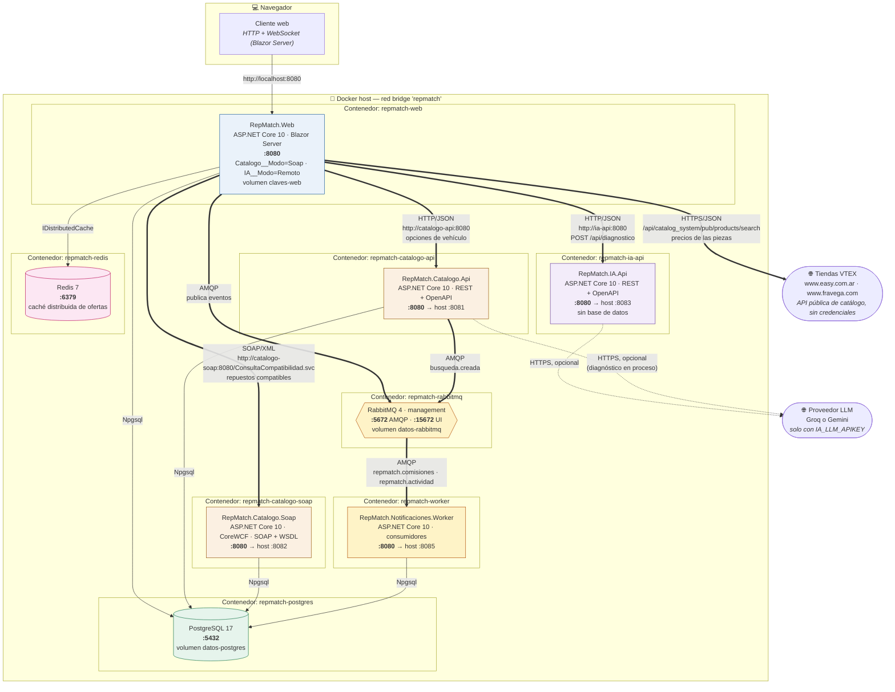
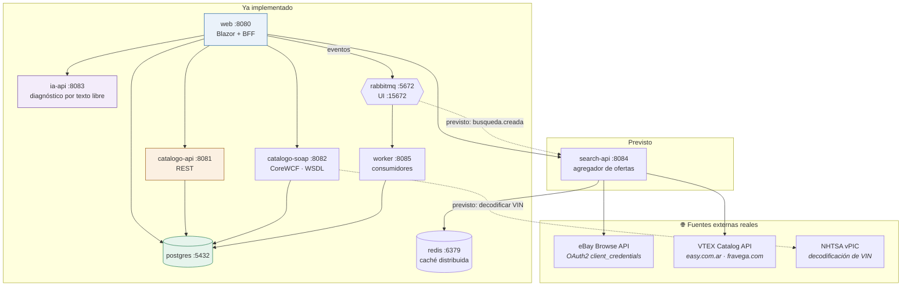

# Diagrama de despliegue — RepMatch

Dos topologías: la **implementada** (TP Inicial, Primera Parte y, de la Segunda Parte, el componente
de IA, el servicio SOAP, las tiendas VTEX con caché Redis y la cola de mensajes), que se levanta
con `docker compose up`, y la **prevista** para las entregas siguientes, que
se documenta acá para mostrar que la arquitectura actual la admite sin rediseño.

## Implementada — TP Inicial, Primera Parte, IA, SOAP, tiendas VTEX y cola



### Nodos

| Nodo | Imagen | Puerto host | Rol |
|---|---|---|---|
| `repmatch-web` | build desde `src/RepMatch.Web/Dockerfile` | 8080 | Capa de presentación + factory del catálogo. Volumen `claves-web` con las claves que cifran la sesión del navegador, para que sobreviva a la recreación del contenedor |
| `repmatch-catalogo-api` | build desde `src/RepMatch.Catalogo.Api/Dockerfile` | 8081 | Host remoto del componente de catálogo. Las búsquedas creadas por su API se diagnostican en proceso |
| `repmatch-catalogo-soap` | build desde `src/RepMatch.Catalogo.Soap/Dockerfile` | 8082 | Host SOAP del componente de catálogo (CoreWCF). Publica el WSDL en `/ConsultaCompatibilidad.svc?wsdl` y resuelve con el mismo `CatalogoLocal` que `catalogo-api` |
| `repmatch-ia-api` | build desde `src/RepMatch.IA.Api/Dockerfile` | 8083 | Host REST del componente de IA. Sin base: recibe los candidatos en la petición. Sin clave de LLM responde el clasificador local |
| `repmatch-postgres` | `postgres:17-alpine` | 5432 | Persistencia, con volumen nombrado |
| `repmatch-redis` | `redis:7-alpine` | — | Caché distribuida de las respuestas VTEX, compartida por las instancias de Web |
| `repmatch-rabbitmq` | `rabbitmq:4-management` | 5672, 15672 | Broker de mensajes. Exchange `repmatch.eventos`, colas durables y DLQ ([flujo de mensajes](mensajes.md)). `hostname` fijo y volumen `datos-rabbitmq`, para que las colas durables sobrevivan a recrear el contenedor |
| `repmatch-worker` | build desde `src/RepMatch.Notificaciones.Worker/Dockerfile` | 8085 | Consumidor de la cola: registro de comisiones por tienda y log de actividad. `/salud` y `GET /api/comisiones`. Espera a `rabbitmq`, `postgres` y `catalogo-api` (que crea el esquema) |
| `repmatch-tienda-simulada` | build desde `tests/RepMatch.TiendaSimulada/Dockerfile`, perfil `simulacion` | — | Solo para las pruebas de punta a punta: responde como VTEX con búsquedas reales grabadas. `scripts/e2e.sh` apunta la Web acá con `OFERTAS_URL_EASY` y `OFERTAS_URL_FRAVEGA` |

La Web no depende de `rabbitmq` para arrancar: si el broker no está, publicar falla, se registra y
la operación de la persona sigue. La Web sale a internet para consultar los precios en las tiendas. Sin salida, o con una tienda caída,
la búsqueda funciona igual: muestra el diagnóstico y las piezas con un aviso de que no se pudieron
consultar los precios.

Las imágenes .NET son multi-etapa: se compila con `mcr.microsoft.com/dotnet/sdk:10.0` y se publica
sobre `mcr.microsoft.com/dotnet/aspnet:10.0`, que no lleva compilador. Los servicios .NET corren como
usuario `app`, sin privilegios de root.

`postgres` declara un `healthcheck` con `pg_isready` y los servicios .NET que usan la base dependen de
`condition: service_healthy`; `redis` verifica `redis-cli ping` y la Web espera también a que esté
saludable. La Web espera además a que `catalogo-api`, `catalogo-soap` e `ia-api` respondan `/salud`:
sin eso, la API arranca antes de que la base acepte conexiones. Como
segunda red de seguridad, `ExtensionesPersistencia.InicializarBaseAsync` reintenta hasta diez veces
con espera creciente.

### Los modos de ejecución

| Modo | Cómo se levanta | Qué demuestra |
|---|---|---|
| **Local** | `Catalogo__Modo=Local` | Invocación directa en proceso: la Web resuelve el catálogo por referencia de proyecto y no genera tráfico hacia `catalogo-api` |
| **Remoto** | `Catalogo__Modo=Remoto` | Invocación remota: cada consulta sale por HTTP al otro contenedor, y el mismo `X-Correlation-Id` aparece en los logs de ambos |
| **Soap** | `Catalogo__Modo=Soap` *(por defecto en compose)* | Los repuestos salen por SOAP hacia `catalogo-soap` y las opciones de vehículo por REST hacia `catalogo-api`: cada búsqueda usa los dos protocolos, con el mismo `X-Correlation-Id` en los tres logs |

La IA tiene los mismos dos modos con `IA__Modo`: `Remoto` en el servicio `web` de compose y `Local`
en `web-local`.

Fuera de contenedores, para desarrollo:

```bash
dotnet run --project src/RepMatch.Catalogo.Api --urls http://localhost:5081
```

```bash
dotnet run --project src/RepMatch.Catalogo.Soap --urls http://localhost:5082
```

```bash
dotnet run --project src/RepMatch.IA.Api --urls http://localhost:5083
```

```bash
dotnet run --project src/RepMatch.Web --urls http://localhost:5080
```

## Topología prevista — Segunda Parte e Integrador

Ninguno de los nodos nuevos obliga a cambiar los componentes ya construidos: `search-api` consume el
mismo `ICatalogoRepuestos`, igual que ya lo hace el cliente de `catalogo-soap`, y las mismas
`IFuenteOfertas` que hoy usa la Web en proceso para consultar VTEX.



### Requisitos externos de la topología prevista

| Servicio | Credenciales | Estado verificado |
|---|---|---|
| eBay Browse API | App ID + Cert ID (registro gratuito) | 5000 llamadas/día |
| VTEX `easy.com.ar` | ninguna | ✅ Implementado: HTTP 206; del catálogo semilla publica baterías |
| VTEX `fravega.com` | ninguna | ✅ Implementado: HTTP 206; marketplace, sobre todo accesorios |
| NHTSA vPIC | ninguna | ✅ HTTP 200 |
| LLM (Groq o Gemini, ya usado por `ia-api`) | clave del proveedor en `IA_LLM_APIKEY`, opcional | sin probar con clave real; sin clave responde el clasificador local |
| MercadoLibre | — | ❌ descartado: `403 forbidden`, cerraron la búsqueda pública |
