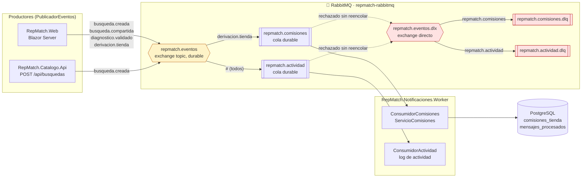

# Flujo de mensajes — RepMatch

La cola de la Segunda Parte (issues #12, #13 y #14): quién publica, por dónde viaja cada mensaje y
quién lo consume. Los mensajes son **eventos de integración**: hechos que ya ocurrieron y quedaron
guardados ("se compartió una consulta"), no mails ni notificaciones. Lo que se hace con cada hecho lo
decide el consumidor.

## Topología

## Eventos

| Clave de ruteo | Evento de dominio | Lo publica | Datos (`*V1`) | Lo consume |
|---|---|---|---|---|
| `busqueda.creada` | `BusquedaCreada` | `ServicioBusquedas.CrearAsync`, desde la Web o `POST /api/busquedas` | búsqueda, cliente, vehículo. **Sin el texto libre** | `repmatch.actividad` |
| `busqueda.compartida` | `BusquedaCompartida` | `ServicioRevisiones.CompartirAsync` | búsqueda, cliente, mecánico | `repmatch.actividad` (lugar previsto para avisarle al mecánico) |
| `diagnostico.validado` | `DiagnosticoValidado` | `ServicioRevisiones.RevisarAsync` | búsqueda, cliente, mecánico, confirmado, códigos propuestos y recomendados | `repmatch.actividad` (lugar previsto para avisarle al cliente) |
| `derivacion.tienda` | `DerivacionATienda` | `ServicioDerivaciones.DerivarAsync` (`GET /derivar/{id}`) | derivación, búsqueda, oferta, tienda, mecánico | `repmatch.comisiones` y `repmatch.actividad` |

Todos viajan en el mismo sobre, `MensajeIntegracion<T>`: `mensajeId`, `tipo`, `version`,
`ocurridoEn`, `correlationId` y `datos`, en JSON. El `X-Correlation-Id` va además como cabecera AMQP.

## Garantías y límites

| Qué | Cómo |
|---|---|
| Se publica solo lo que quedó guardado | El despachador corre después de `ConfirmarAsync` y `PublicadorEventos` es el último observador |
| Sobrevive a un reinicio del broker | Exchanges y colas durables, mensajes persistentes y un volumen con hostname fijo en compose |
| El broker confirma cada publicación | Canal con *publisher confirms*: si no confirma, la publicación lanza y queda en el log |
| Broker caído | La operación de la persona sigue; la publicación falla y se registra. Después de una falla no se reintenta conectar por 30 s (`PausaTrasFallaSegundos`), así nadie espera el timeout en cada clic |
| Mensaje que falla | Se confirma recién después de procesarlo. Si falla, vuelve una vez a la cola; si falla de nuevo, o si no se puede leer, va a su DLQ |
| Mensaje repetido | `ServicioComisiones` guarda `mensajes_procesados` (clave mensaje + consumidor) en la misma transacción que la suma: una segunda entrega no suma |
| Pérdida posible | Un mensaje publicado con el broker caído se pierde (no hay outbox). El hecho sigue en la base |

## Seguir un mensaje en la demo

1. `http://localhost:15672` (usuario `repmatch`, contraseña `repmatch`) → **Queues**: las cuatro colas,
   durables, con sus DLQ.
2. En la Web, buscar la batería del Gol e "Ir a la tienda". En **Queues → repmatch.comisiones** se
   ve pasar el mensaje.
3. `http://localhost:8085/api/comisiones` muestra la derivación sumada a la tienda y el mes.
4. `docker compose stop worker`, salir otra vez a la tienda: el mensaje queda esperando en la cola
   (**Ready: 1**). `docker compose start worker` y la cuenta sube.
5. `docker compose logs web worker | grep <correlation id>`: el mismo id en los dos procesos.

Código de referencia: [PublicadorEventos.cs](../../src/RepMatch.Aplicacion/Eventos/PublicadorEventos.cs),
[BusRabbitMq.cs](../../src/RepMatch.Mensajeria/BusRabbitMq.cs),
[TopologiaRabbitMq.cs](../../src/RepMatch.Mensajeria/TopologiaRabbitMq.cs),
[ConsumidorRabbitMq.cs](../../src/RepMatch.Mensajeria/ConsumidorRabbitMq.cs) y
[ConsumidorComisiones.cs](../../src/RepMatch.Notificaciones.Worker/Consumidores/ConsumidorComisiones.cs).
