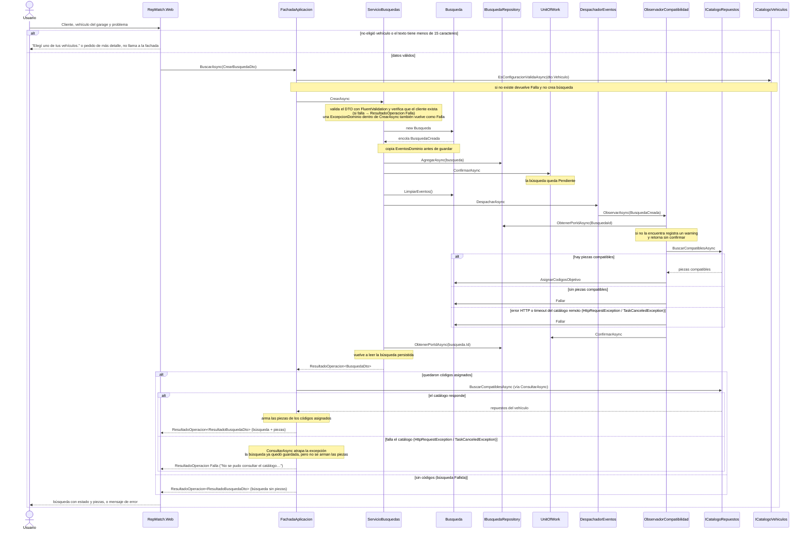
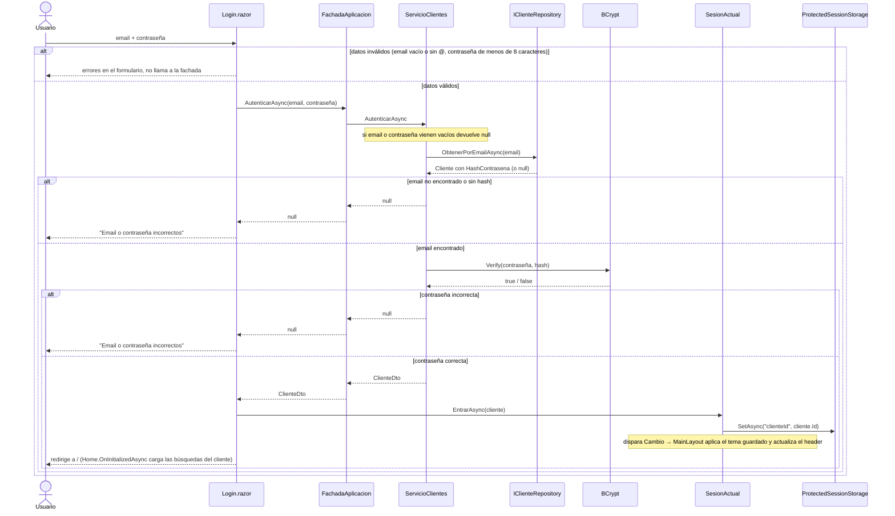
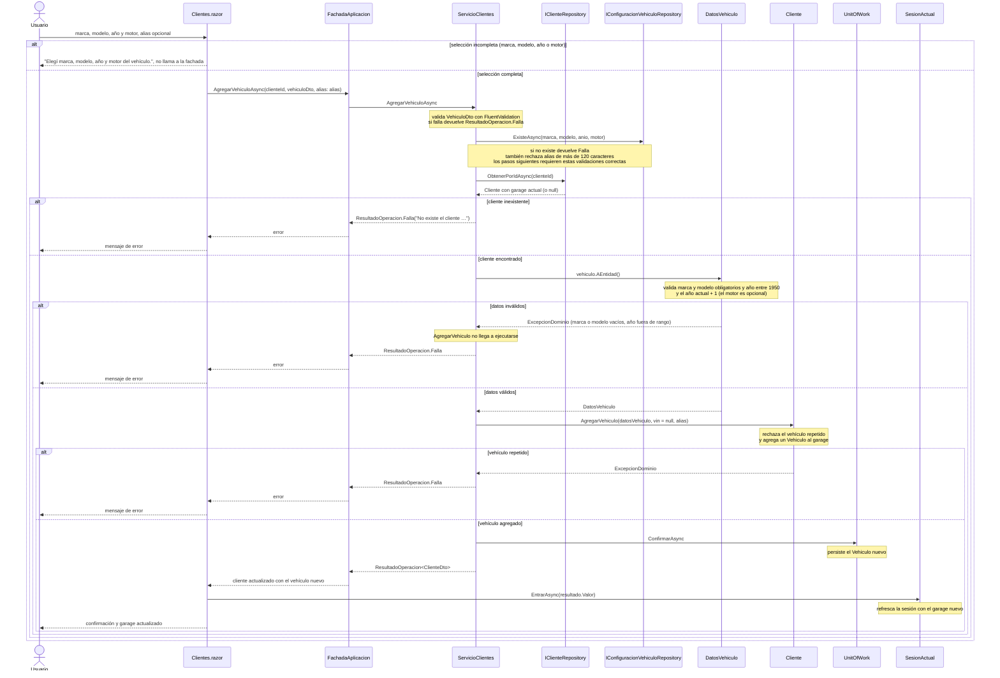
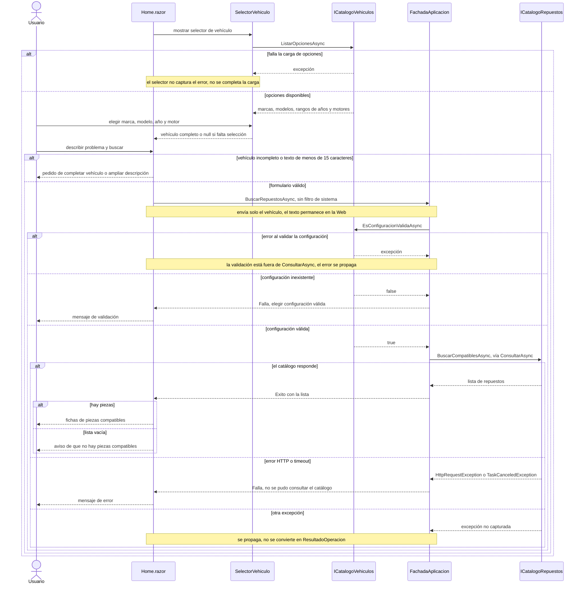
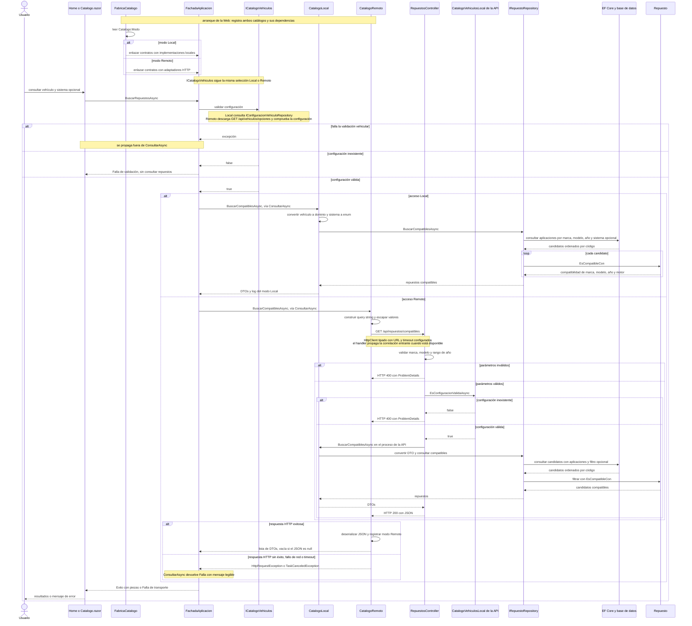
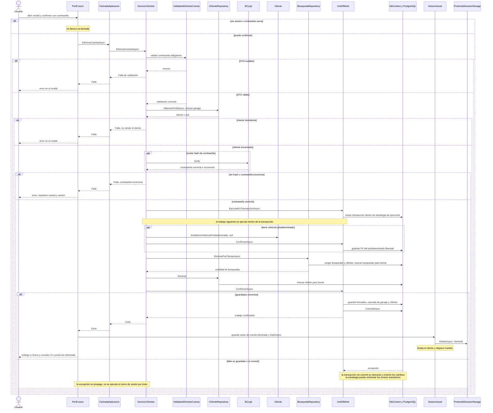

# Diagramas de secuencia

---

## 1. Registrar una búsqueda

Caso de la Primera Parte: el cliente elige un vehículo del garage, describe el problema, y la
búsqueda queda guardada con los códigos de las piezas compatibles. El texto libre se persiste. La
elección de piezas la hace el observador de `BusquedaCreada`, por compatibilidad de vehículo; la
fachada después arma las piezas completas para mostrarlas.

---

## 2. Autenticación (login)

El usuario ingresa con email y contraseña. La contraseña nunca se almacena: solo su hash BCrypt.
`SesionActual` guarda el id del cliente en el almacenamiento de sesión del browser, cifrado por
ASP.NET Core Data Protection. El registro de una cuenta nueva usa otro camino desde la misma
pantalla: `RegistrarClienteAsync` (validación FluentValidation, rechazo de email duplicado y
`BCrypt.HashPassword`) y después `EntrarAsync`.

---

## 3. Alta de un vehículo

El cliente agrega un auto a su garage. Las reglas de negocio viven en el dominio: marca y modelo
obligatorios y año entre 1950 y el año actual + 1 (`DatosVehiculo`), vehículo no repetido para el
mismo cliente (`Cliente.AgregarVehiculo`) y VIN válido si se informa (`Vehiculo`; la Web no manda
VIN). `AgregarVehiculoAsync` valida el DTO con FluentValidation, verifica que exista la
configuración en el catálogo y controla que el alias no supere 120 caracteres. Luego busca el cliente,
delega en el dominio y persiste.

---

## 4. Búsqueda sin sesión

El visitante selecciona un vehículo y describe el problema en Home. El texto se valida en la Web,
pero no se envía a la fachada: esta consulta devuelve piezas, sin crear una `Busqueda`, guardar
historial ni despachar `BusquedaCreada`. La carga de los selectores y la validación del vehículo
usan `ICatalogoVehiculos`, el acceso concreto se elige con la misma fábrica que los repuestos.

Código de referencia: [Home.razor](../../src/RepMatch.Web/Components/Pages/Home.razor),
[SelectorVehiculo.razor](../../src/RepMatch.Web/Components/SelectorVehiculo.razor) y
[FachadaAplicacion.cs](../../src/RepMatch.Aplicacion/Fachada/FachadaAplicacion.cs).

---

## 5. Consulta de repuestos: acceso local y remoto

El ejemplo es una consulta de compatibilidad desde la fachada. Factory selecciona las estrategias
al arrancar, los consumidores usan los contratos. En modo Remoto, Adapter construye la petición
HTTP y devuelve DTOs. En ambos caminos, Repository consulta los candidatos con EF Core y el
dominio decide la compatibilidad de motor. La API siempre usa los catálogos locales.

Las excepciones que no sean HTTP o timeout no las captura `ConsultarAsync`, se propagan.
Esta secuencia es de consulta: no crea búsquedas ni escribe datos. En la búsqueda con cuenta,
el observador y la fachada consumen el mismo contrato, como muestra la secuencia 1.

Código de referencia: [FabricaCatalogo.cs](../../src/RepMatch.Web/Servicios/FabricaCatalogo.cs),
[CatalogoLocal.cs](../../src/RepMatch.Aplicacion/Catalogo/CatalogoLocal.cs),
[CatalogoRemoto.cs](../../src/RepMatch.Clientes.Rest/CatalogoRemoto.cs),
[RepuestosController.cs](../../src/RepMatch.Catalogo.Api/Controllers/RepuestosController.cs) y
[RepuestoRepository.cs](../../src/RepMatch.Persistence/Repositorios/RepuestoRepository.cs).

---

## 6. Eliminación de cuenta

El usuario confirma la baja desde el modal de Perfil con su contraseña. El servicio valida el DTO,
comprueba el cliente y verifica el hash antes de borrar. Con PostgreSQL, Unit of Work ejecuta los
guardados dentro de una sola transacción: primero libera el vehículo predeterminado, si existe,
y después elimina búsquedas y cliente. El garage y las ofertas se eliminan por cascada.

La transacción del diagrama corresponde a PostgreSQL. Con InMemory, `EjecutarEnTransaccionAsync`
ejecuta el trabajo directamente, sin transacción ni rollback entre guardados.

Código de referencia: [Perfil.razor](../../src/RepMatch.Web/Components/Pages/Perfil.razor),
[ServicioClientes.cs](../../src/RepMatch.Aplicacion/Servicios/ServicioClientes.cs),
[UnitOfWork.cs](../../src/RepMatch.Persistence/UnitOfWork.cs),
[BusquedaRepository.cs](../../src/RepMatch.Persistence/Repositorios/BusquedaRepository.cs) y
[SesionActual.cs](../../src/RepMatch.Web/Servicios/SesionActual.cs).
